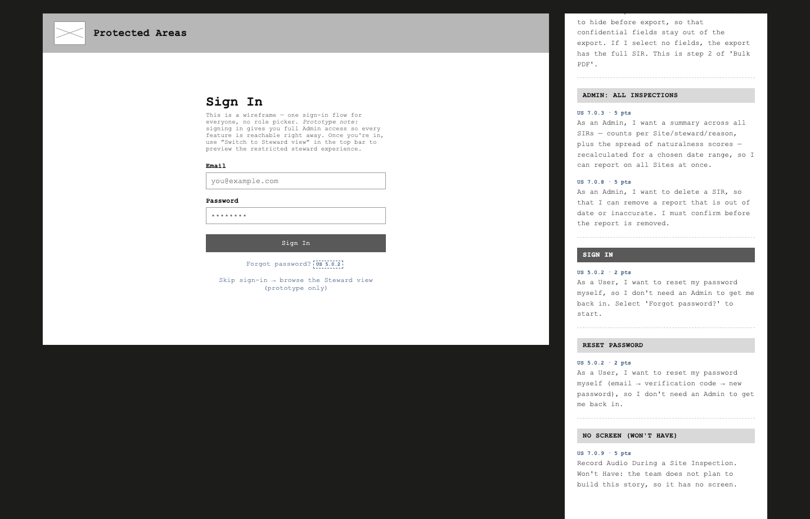
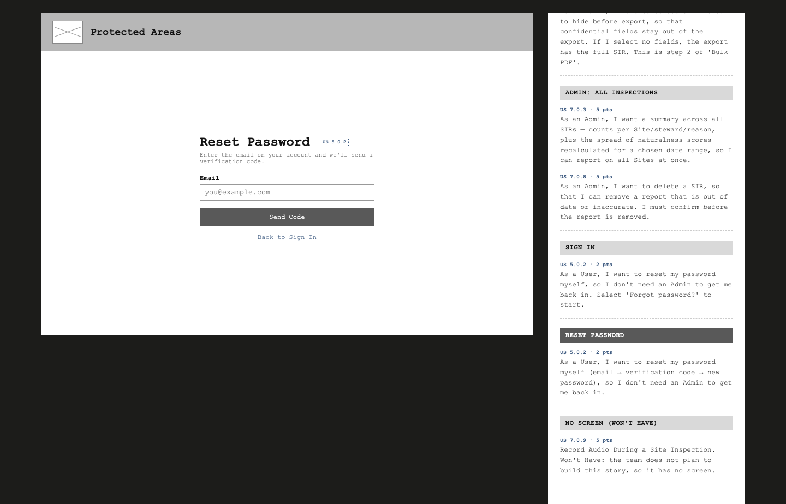
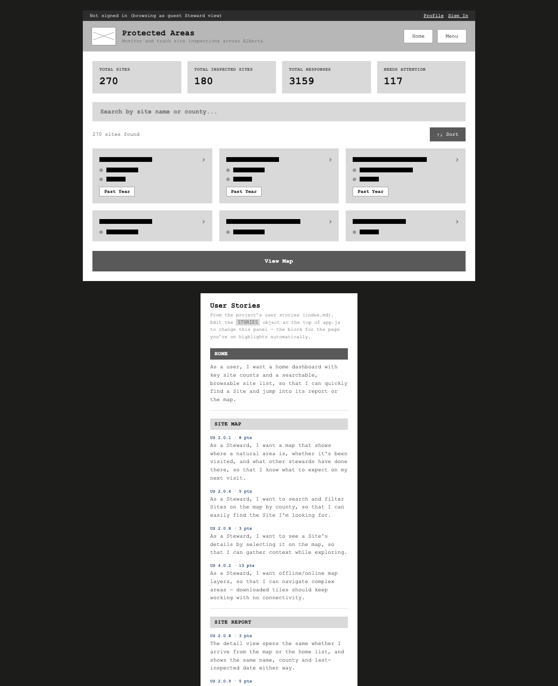
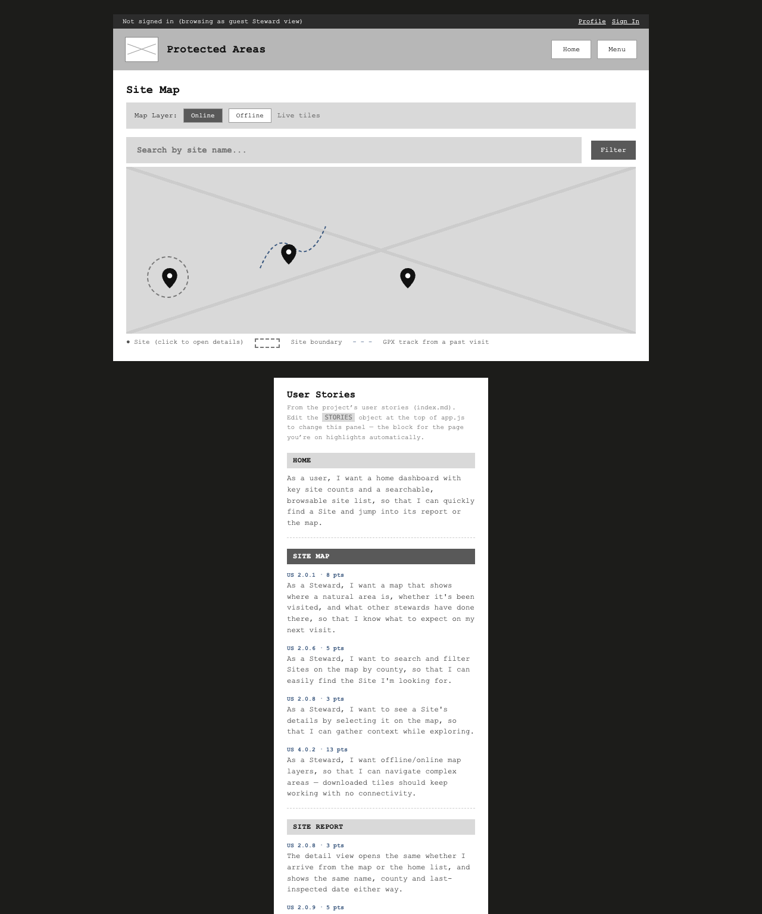
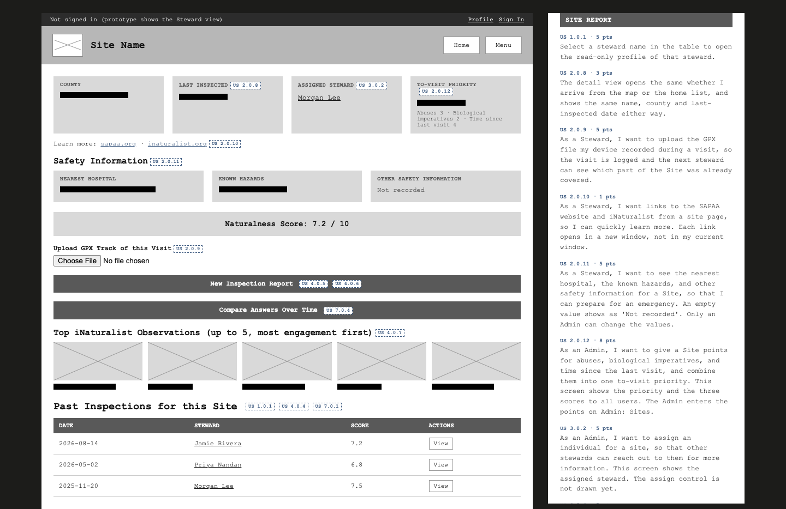
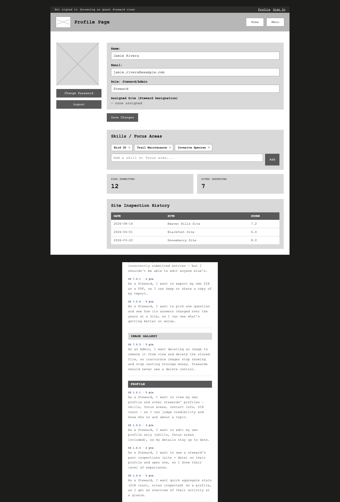
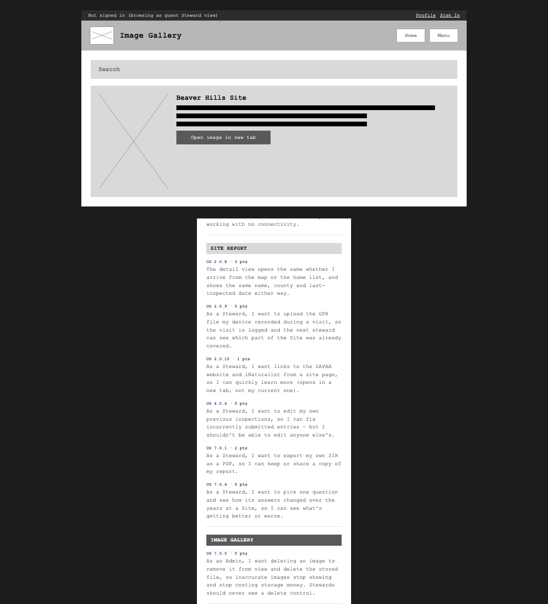
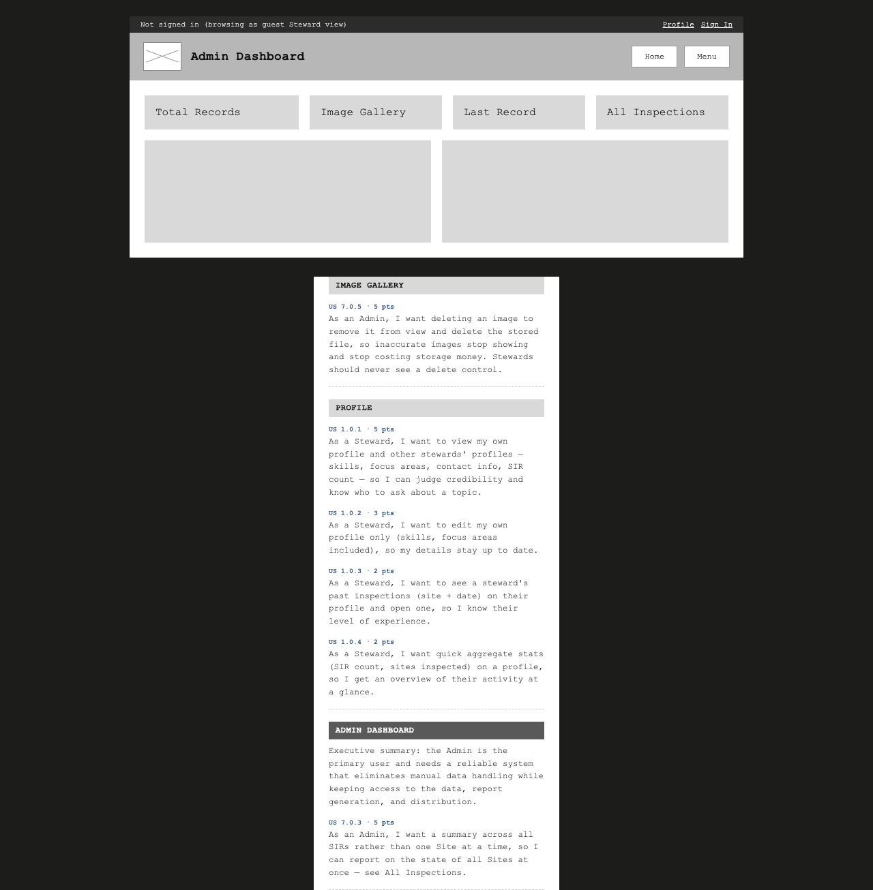
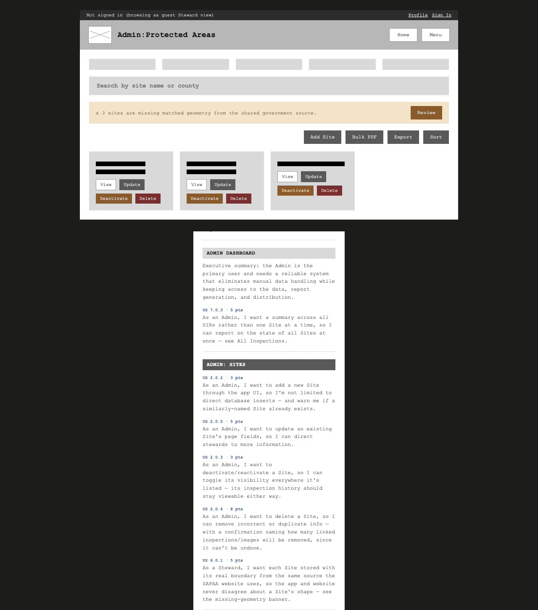
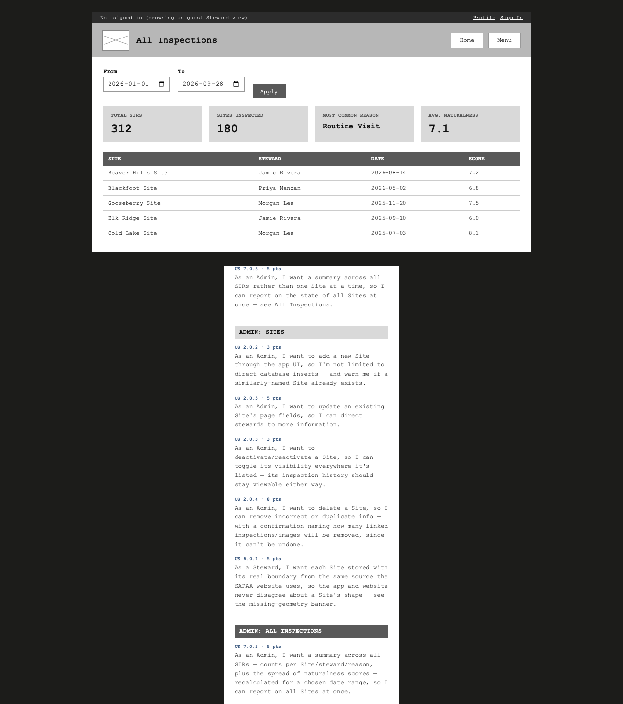

# Low-Fidelity Wireframes (Fall 2026)

This page shows the low-fidelity wireframes for the web app. The wireframes show the functions that the team plans to make. They do not show the final visual design.

The wireframes use three personas from the [user stories](../user-stories.md): User, Steward, and Admin.

## Open the interactive prototype

[Open the interactive prototype (home.html)](home.html)

Each screen is a static HTML page. Use the links and buttons to move between the screens.

* The prototype has one sign-in flow. When you sign in, you get Admin access. To see the Steward view, select "Switch to Steward view" in the top bar.
* A dashed label, for example `US 2.0.2`, is on each element that a user story needs. The label gives the story number.
* The "User Stories" panel on the right of each screen shows the stories for all screens. The panel highlights the stories for the current screen. The last group in the panel lists the stories that have no screen yet.
* The prototype keeps the sign-in state in the local storage of your browser. It does not send data to a server.

A static image of all screens is also available: [wireframe-F26.png](../wireframe-F26.png).

## UI flow

The diagram shows the navigation paths between the screens. It comes from the links in the HTML pages.

| From page | To page | Action |
|---|---|---|
| Sign In (`signin.html`) | Reset Password (`reset-password.html`) | Select "Forgot password?" |
| Sign In | Home (`home.html`) | Select "Sign In" or "Skip sign-in" |
| Reset Password | Sign In | Select "Back to Sign In" |
| Home | Site Report (`report.html`) | Select a site card |
| Home | Site Map (`map.html`) | Select "View Map" |
| Site Map | Site Report | Select a site pin |
| Site Report | Profile (`profile.html`) | Select a steward name. The link goes through `profile-view.html`, which opens `profile.html` in read-only mode. |
| Profile | Site Report | Select a row in "Site Inspection History" |
| Admin Dashboard (`admin-dashboard.html`) | Image Gallery (`gallery.html`) | Select the "Image Gallery" card |
| Admin Dashboard | Site Report | Select the "Last Record" card |
| Admin Dashboard | Admin: All Inspections (`admin-inspections.html`) | Select the "All Inspections" card or the Menu item |
| Admin pages | Admin: Sites (`admin-sites.html`) | Select Menu, then "Sites" |
| Admin: Sites | Site Report | Select "View" on a site card |
| Admin: All Inspections | Site Report | Select a table row |
| Any page with a top bar | Home | Select "Home", "Logout", or "Sign Out" |
| Any page with a top bar | Profile | Select your name (signed in) or "Profile" (signed out) |
| Any page with a top bar | Sign In | Select "Sign In" (signed out only) |
| Home, Site Map, Site Report, Profile, Image Gallery | Image Gallery | Select Menu, then "Image Gallery" |
| Home, Site Map, Site Report, Profile, Image Gallery | Admin Dashboard | Select Menu, then "Admin" |

## Screens

| Screen | Screenshot |
|---|---|
| Sign In |  |
| Reset Password |  |
| Home |  |
| Site Map |  |
| Site Report |  |
| Profile |  |
| Image Gallery |  |
| Admin Dashboard |  |
| Admin: Sites |  |
| Admin: All Inspections |  |

The screenshots were made before the story labels were added to the screens. The `screenshots/` folder has more states of each screen.

## User story coverage

This table lists all 35 stories in [User Stories](../user-stories.md). 22 stories have a screen. 13 stories have no screen yet.

| Story | Title | Wireframe screen(s) |
|---|---|---|
| US 1.0.1 | Add User Profiles | Profile (own and read-only view of other stewards); Site Report (steward name links) |
| US 1.0.2 | Allow Editing Own Profile | Profile (own profile, "Save Changes", skills and focus areas) |
| US 1.0.3 | Show history of Site Inspections on a Steward's Profile | Profile ("Site Inspection History") |
| US 1.0.4 | Aggregate User Activity and Contributions on a user's profile | Profile ("SIRs Submitted", "Sites Inspected") |
| US 1.0.5 | Earn Points for Inspection Activity | No screen yet |
| US 2.0.1 | View Sites and Past Visits on an Interactive Map | Site Map (boundaries, pins, GPX track) |
| US 2.0.2 | Allow Admins to Add New Sites | Admin: Sites ("Add Site" form, duplicate warning, required fields, "Select Boundary on Map") |
| US 2.0.3 | Deactivate and Reactivate a Site | Admin: Sites ("Deactivate" and "Reactivate") |
| US 2.0.4 | Delete a Site | Admin: Sites ("Delete" with a confirmation that gives the linked record count) |
| US 2.0.5 | Update a Site | Admin: Sites ("Update" panel with fields to show or hide) |
| US 2.0.6 | Search and Filter Sites by County on the Map | Site Map (search box, county filter) |
| US 2.0.8 | View a Site's Details From the Map | Site Map (site pin); Site Report (county, last inspected); Home (site cards) |
| US 2.0.9 | Upload a GPX Track of a Site Visit | Site Report ("Upload GPX Track of this Visit") |
| US 2.0.10 | Add links to Site Page | No screen yet |
| US 2.0.11 | Show Safety Information for a Site | No screen yet |
| US 2.0.12 | Score a Site for To-Visit Priority | No screen yet |
| US 2.0.13 | Flag Site Points That Are a Year Old | No screen yet |
| US 3.0.2 | Steward Designation | Site Report ("Assigned Steward"); Profile ("Assigned Site"). Partial: the screens show the assignment only. The Admin control to search for and assign a steward is not drawn. |
| US 3.0.3 | Export all digital files from SIR-SAPAA | No screen yet. Admin: Sites has an "Export" button with no story label. The team must confirm its purpose. |
| US 4.0.2 | Offline and Online Map Layers | Site Map ("Online" and "Offline" layer switch, offline banner) |
| US 4.0.4 | Edit My Previous Inspections | Site Report ("Edit" on your own inspection, Steward view only) |
| US 4.0.5 | iNaturalist integration | No screen yet |
| US 4.0.6 | Demote Photo Identifier to optional field | No screen yet |
| US 4.0.7 | Show the Top iNaturalist Observations for a Site | No screen yet |
| US 5.0.2 | Reset a Forgotten Password | Sign In ("Forgot password?"); Reset Password (email, code, new password, done) |
| US 5.0.4 | Sign Out Properly | Top bar "Sign Out" and Menu "Logout" on each signed-in screen |
| US 6.0.1 | Store Each Site's Geometry From the Shared Source | Admin: Sites (banner for sites with no matched geometry) |
| US 7.0.1 | Let Stewards Export Their Own Reports | Site Report ("Export PDF" on your own inspection, Steward view only) |
| US 7.0.3 | See All Inspections in One View | Admin: All Inspections (date range, summary figures); Admin Dashboard ("All Inspections" card) |
| US 7.0.4 | Compare One Question Across Years | Site Report ("Compare Answers Over Time") |
| US 7.0.5 | Delete an Image and Clean Up After It | Image Gallery ("Delete" for Admin only, with confirmation) |
| US 7.0.6 | Export More Than 50 Site Inspection Reports | No screen yet. Admin: Sites has a "Bulk PDF" button with no story label. The team must confirm its purpose. |
| US 7.0.7 | Hide Fields on a SIR Before Export | No screen yet |
| US 7.0.8 | Delete a Site Inspection Report | No screen yet |
| US 7.0.9 | Record Audio During a Site Inspection | No screen yet |

### Differences between the wireframe and the stories

The team must decide how to fix these differences. This page does not change the stories or the screens for them.

* US 1.0.4: the story asks for the SIR count and the activities reported. The Profile screen shows "SIRs Submitted" and "Sites Inspected".
* US 5.0.2: the story says that a reset link goes to the email of the user. The Reset Password screen sends a 6-digit code and does not use a link.
* US 2.0.5: the story says that the Admin uses "edit mode" on a site page. The wireframe puts "Update" on the Admin: Sites list, not on the Site Report.
* Admin: Sites has a "Site Visibility" field (Public or Stewards Only) in the "Add Site" form. No story asks for this field.

## Client feedback

The client reviewed the wireframes in the client meeting on Friday, September 25, 2026, and said that they are acceptable. See the [meeting minutes](../meeting-minutes.md). The client asked for no changes.