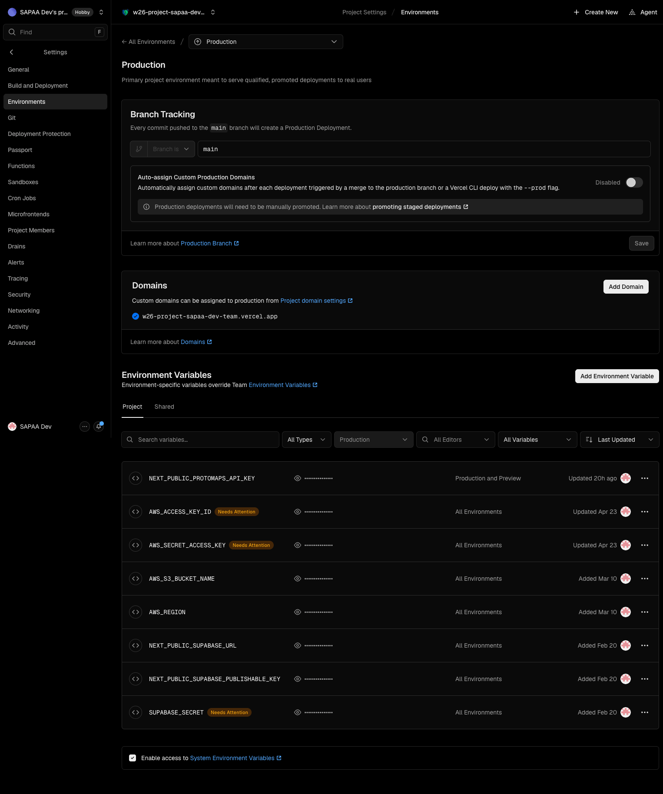
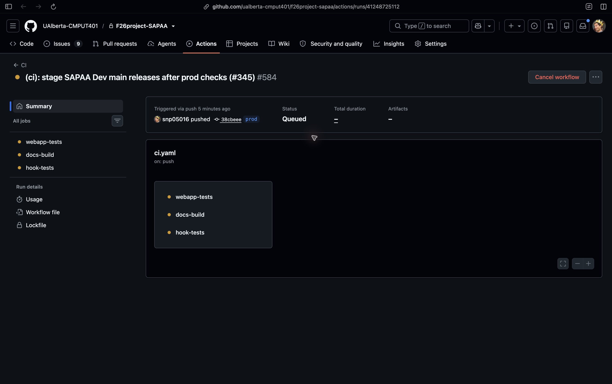
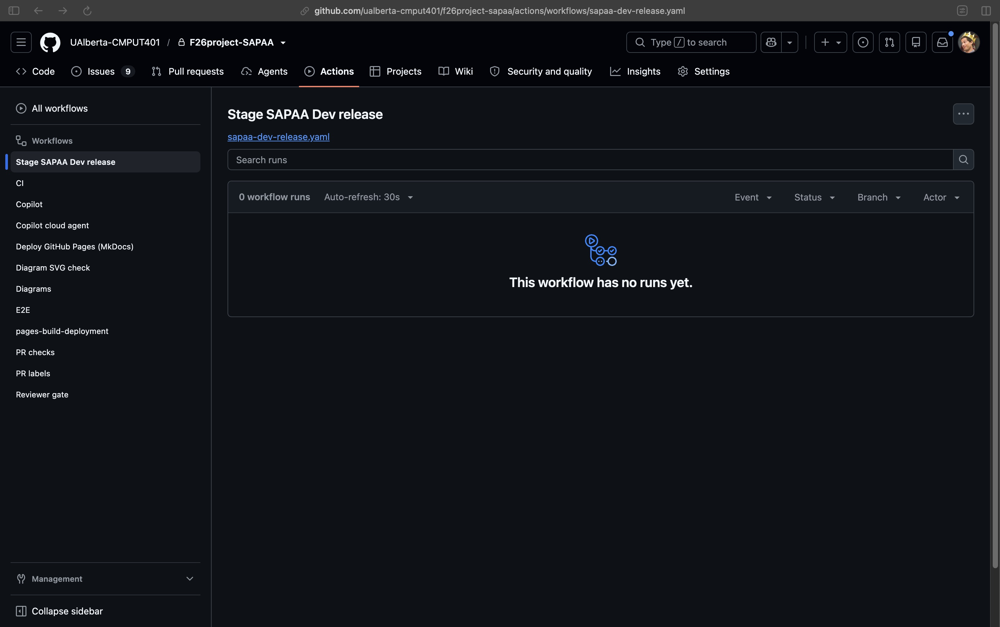
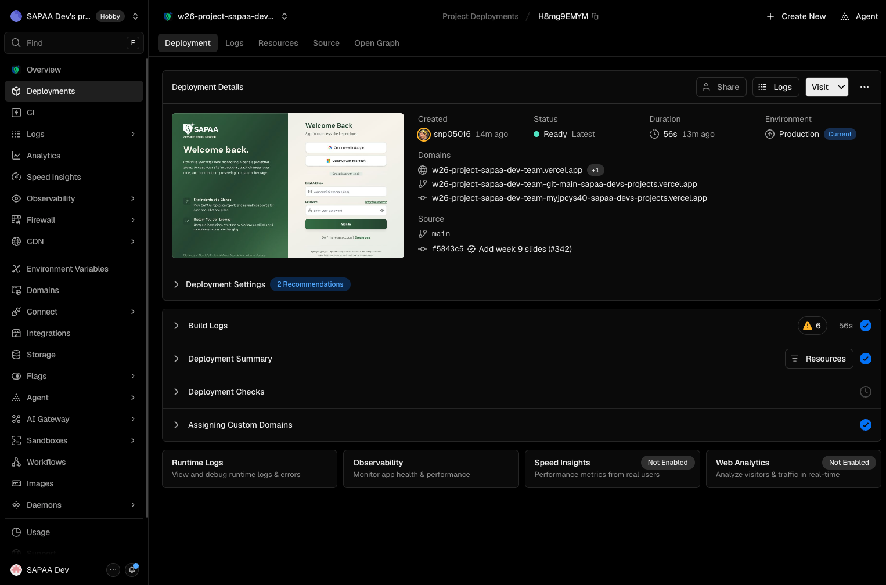

# SAPAA Dev production deployment

Verified on **October 31, 2026**. This guide describes the SAPAA Dev web app. It does not deploy StewardLog in `FNR/`.

## 1. Accounts, projects, and source

| Service | Account or project | Use |
| --- | --- | --- |
| Course GitHub | [UAlberta-CMPUT401/F26project-SAPAA](https://github.com/UAlberta-CMPUT401/F26project-SAPAA) | Course source, reviews, and documents |
| Deployment GitHub | [SAPAA-Dev/W26Project-SAPAA-Dev-Team](https://github.com/SAPAA-Dev/W26Project-SAPAA-Dev-Team) | Repository connected to the new Vercel project |
| Vercel | [sapaa-devs-projects / w26-project-sapaa-dev-team](https://vercel.com/sapaa-devs-projects/w26-project-sapaa-dev-team) | Builds and production releases |
| Team service email | `devteams@sapaastewards.com` | Team service account; use the team's approved sign-in method |
| Supabase organization | `CMPUT401 SAPAA` | Database and authentication management |
| Supabase project | [CMPUT401 SAPAA Proof of Concept](https://supabase.com/dashboard/project/yizmvkfkgahyoqeznvki) | The shared production database, Auth, and Storage |
| Protomaps | `devteams@sapaastewards.com` | Production map key, named **SAPAA Dev production** |
| Production website | [w26-project-sapaa-dev-team.vercel.app](https://w26-project-sapaa-dev-team.vercel.app) | Stable user address |

GitHub organizations are not shared login usernames. Sign in with your own GitHub account that has repository access. Supabase organization membership, Vercel membership, and app admin approval are separate permissions.

The course `main` was copied to SAPAA-Dev `main` at `f5843c5def8104c872bfe479b4dc41d77a8e47f5`. Vercel deployment [H8mg9EMYMCyTbf4XE9qoEfwpsbAZ](https://vercel.com/sapaa-devs-projects/w26-project-sapaa-dev-team/H8mg9EMYMCyTbf4XE9qoEfwpsbAZ) showed **Ready**, source **main**, and the stable production domain. Do not deploy from `feat/ui-prototypes`.

The approved release flow is:

```text
Course main → course prod → CI passes → SAPAA-Dev main
                                             ↓
                                  Vercel staged Production build
                                             ↓
                                  Frank selects Promote to Production
                                             ↓
                                  Stable production website changes
```

Vercel tracks SAPAA-Dev **main**. **Auto-assign Custom Production Domains is disabled**, as verified in Settings → Environments → Production on October 31. A new build must be promoted before it changes the stable website. The existing live deployment stays in place while the next build runs.

The sync workflow was merged to course `main` in [PR #345](https://github.com/UAlberta-CMPUT401/F26project-SAPAA/pull/345). The restricted App and Actions credentials are configured. The first hosted run was blocked before tests by the course account billing settings. The owner selected the existing self-hosted runner for CI and release sync. The full run must still be verified after that configuration is merged. See section 6 for setup and release checks. A push to course `main` alone is not a release. The course repository is private: use a GitHub account with course access for its links. SAPAA-Dev and Vercel access are separate.

## 2. PostgreSQL usernames and connection details

These are connection names, not passwords. The app uses Supabase HTTPS APIs with its server and public keys. It does **not** need a direct PostgreSQL password in Vercel for the current web app.

| Connection | Host | Port | Database | Username |
| --- | --- | --- | --- | --- |
| Direct | `db.yizmvkfkgahyoqeznvki.supabase.co` | `5432` | `postgres` | `postgres` |
| Session pooler | `aws-1-ca-central-1.pooler.supabase.com` | `5432` | `postgres` | `postgres.yizmvkfkgahyoqeznvki` |

The direct connection uses IPv6 by default. The session pooler supports IPv4. These values were read from **Connect → Direct → Connection Method** in the project dashboard. Recheck that page before use because service settings can change. See [Supabase connection documentation](https://supabase.com/docs/guides/database/connecting-to-postgres).

1. Open the Supabase project above.
2. Select **Connect** at the top of the project page.
3. Select **Direct / Connection string**.
4. Select **Direct connection** or **Session pooler** for your network.
5. Read the **Connection parameters**: host, port, database, and user.
6. Obtain the database password from the team's approved credential store or project owner. `[YOUR-PASSWORD]` in the dashboard is a placeholder. A Supabase login password, an app password, and the database password are different credentials.
7. Use SSL. Do not paste a password into a shell command, screenshot, chat, or Git commit.

Example read-only session. The password prompt keeps the password out of shell history:

```sh
psql "host=aws-1-ca-central-1.pooler.supabase.com port=5432 dbname=postgres user=postgres.yizmvkfkgahyoqeznvki sslmode=require" -W
```

Then check the connection without changing data:

```sql
BEGIN READ ONLY;
SELECT current_database(), current_user;
ROLLBACK;
```


There is **one live Supabase project**, with no staging database. A Preview website can still write to production. The web inspection tables (`form_responses`, `answers`, `questions`) differ from the legacy StewardLog tables. See [Software Design](software-design.md) and [Contributing](contributing.md).

## 3. Vercel build settings

Open the Vercel project → **Settings → Build and Deployment**.

| Setting | Verified value |
| --- | --- |
| Framework Preset | Next.js |
| Root Directory | `webapp` |
| Build Command | Framework default: `npm run build` / `next build` |
| Output Directory | Next.js default |
| Install Command | Framework default; no override enabled |
| Vercel Node.js Version | `24.x` |
| Course CI Node.js Version | `22` |

The Vercel and CI Node versions are different in the current setup. This guide records that difference; it does not change the team setting. Run the repository checks with Node 22 and confirm the Vercel build result before promotion.


Under **Settings → Git**, confirm the connected repository is **SAPAA-Dev/W26Project-SAPAA-Dev-Team**. Under the Production environment settings, check the automatic branch. Do not assume the displayed production deployment came from that branch: a manual promotion can use a different branch.

## 4. Environment variables

Open **Settings → Environment Variables**. Use the existing team credentials. Values are deliberately absent from this guide.

| Variable | Source | Exposure |
| --- | --- | --- |
| `NEXT_PUBLIC_SUPABASE_URL` | Supabase project API settings | Public project URL |
| `NEXT_PUBLIC_SUPABASE_PUBLISHABLE_KEY` | Supabase public API key | Public key; RLS still applies |
| `SUPABASE_SECRET` | Supabase server API key | Server only; bypasses RLS |
| `NEXT_PUBLIC_PROTOMAPS_API_KEY` | Protomaps account, **SAPAA Dev production** | Browser key, restricted by allowed origin |
| `AWS_ACCESS_KEY_ID` | Existing team AWS IAM credential | Server only |
| `AWS_SECRET_ACCESS_KEY` | Matching AWS credential | Server only |
| `AWS_REGION` | Region of the existing bucket | Server configuration |
| `AWS_S3_BUCKET_NAME` | Existing team bucket | Server configuration |

Check **Production** scope. Check **Preview** scope if previews use these integrations. Never add a secret with a `NEXT_PUBLIC_` prefix. AWS access key IDs are not AWS console login usernames. This release did not verify an AWS console username; obtain console access from the AWS account owner.

After a value changes, make a new deployment. Existing deployments keep their build configuration. Public Next.js values can be included at build time. See [Vercel environment variables](https://vercel.com/docs/environment-variables).

### Protomaps allowed website

The production key permits this exact origin:

```text
https://w26-project-sapaa-dev-team.vercel.app
```

The origin has no page path. A generated Preview address has a different origin, so the production-only key can reject its map requests. **Invalid origin for API key** means the key/origin combination is wrong; it does not mean MapLibre failed to load. Check the production address first. Do not remove origin restrictions to make a preview work. Use an approved preview key or approved allowed origin when needed.

## 5. Get and test the release source

Run from the repository root. The remote names below match the checked local repository: `origin` is the course repository; `upstream` is the deployment repository. The name `upstream` does not change what that remote points to.

```sh
git pull --ff-only
git status --short
git remote -v
git branch --show-current
git fetch origin
git fetch upstream
```

For a release, use a reviewed commit from course `main`. Preserve unrelated local files. Do not force push or reset work to make a deployment easier.

Check that the intended course branches are included:

```sh
git merge-base --is-ancestor origin/main HEAD
git merge-base --is-ancestor origin/sprint-4 HEAD
git log -5 --oneline
```

Exit code zero means the named branch is an ancestor. If a check fails, integrate and review the missing changes before release. Do not copy selected map files without their shared parsers, authorization checks, tests, and API callers.

Run the web checks:

```sh
cd webapp
npm ci --ignore-scripts
npx tsc --noEmit
npm run test:ci
npm run lint -- --max-warnings 0 --ignore-pattern 'coverage/**'
npm run build
```

The build needs environment values. Use the approved local setup. CI uses placeholder Supabase values for a compile check; that check does not prove live credentials work. Never run Cypress against this shared project: its tasks can change production rows. Do not run native builds or the Google Sheets script as release tests.

For documentation changes, run from the repository root:

```sh
mkdocs build --clean
```

The GitHub Pages documentation workflow runs on course `main`. A guide committed to a feature branch is readable in GitHub, but does not reach the published Pages site until the normal review and merge occur.

## 6. Set up and use the release pipeline

### One-time setup

1. Keep `.github/workflows/sapaa-dev-release.yaml`, its sync script, tests, and this guide on course `main` through review. The workflow runs from the default branch when **CI** completes for a push to course `prod`.
2. Register the **SAPAA course release sync** GitHub App under the SAPAA-Dev account. Disable webhooks and user authorization. Permit installation only on that account. Set repository **Contents: Read and write** and **Workflows: Read and write**. Metadata read access is required by GitHub. All other permissions stay off.
3. Install the App on **only** `SAPAA-Dev/W26Project-SAPAA-Dev-Team`. Workflow permission is needed because a full source copy includes `.github/workflows/`. Do not grant repository administration or access to other repositories.
4. Put the App ID in the course repository Actions variable `SAPAA_RELEASE_APP_ID`. Generate an App private key and put its full contents in the Actions secret `SAPAA_RELEASE_APP_KEY`. Keep it out of commits, logs, screenshots, and chat. A repository administrator must do this step. Use the team's approved secure process to remove temporary key files after setup.
5. The course checkout uses its own `GITHUB_TOKEN` to read the private course repository and fetch `prod`. Source objects are copied locally to the separate deployment checkout. The workflow requests a short-lived installation token for the deployment repository only. GitHub's token action revokes it at the end of the job. It does not use a personal token or Vercel token. See [GitHub App authentication](https://docs.github.com/en/apps/creating-github-apps/authenticating-with-a-github-app/making-authenticated-api-requests-with-a-github-app-in-a-github-actions-workflow).
6. In the named Vercel project, confirm **Git → SAPAA-Dev/W26Project-SAPAA-Dev-Team**, **Production branch → main**, and **Auto-assign Custom Production Domains → disabled**. Keep the existing environment values and `webapp` root.

### Who does each step

| Person | Needs access to | Does this |
| --- | --- | --- |
| Developer or release owner | Course repository, including permission to push `prod` | Select the reviewed main commit, push `prod`, and check CI and sync |
| Frank or the production release owner | SAPAA Dev Vercel project with permission to promote | Check the staged main build, select Promote, and check the stable app |
| Account owner | SAPAA-Dev App settings and course Actions settings | Maintain the App installation and encrypted key; this is not needed for each release |

Frank does not need a terminal, database password, AWS key, or App private key to promote an existing ready release. He needs the correct Vercel account and project access. App admin access alone does not grant Vercel access.

### Before each release

1. Open the [course repository](https://github.com/UAlberta-CMPUT401/F26project-SAPAA) using your course GitHub account. If it shows 404, check the account and repository access. Do not create a replacement repository.
2. Confirm the release changes have been reviewed and merged into **main**.
3. Record the full commit ID. A commit ID identifies one version of the code. Keep this same ID through all the checks below.
4. Check whether the release needs a database migration. This pipeline does not apply migrations or copy databases. Use the existing approved migration process when needed.
5. Open [Vercel Production settings](https://vercel.com/sapaa-devs-projects/w26-project-sapaa-dev-team/settings/environments/production). Check **main** and **Disabled** as shown below. Do not enable automatic domain assignment to fix a slow build.



### Developer: start and check a release

1. Finish the normal course reviews, merge into course `main`, and check the result. Apply only reviewed and approved database migrations by the existing manual process before incompatible code goes live. The pipeline runs no production SQL.
2. In a clean checkout, fetch course `main` and move course `prod` forward to that reviewed commit. These commands do not switch or change the current local branch:

   ```sh
   git fetch origin main
   git log -1 --oneline origin/main
   git push origin origin/main:refs/heads/prod
   ```

   This creates `prod` on the first release. Never force push it. If the push fails, inspect the branch difference. Do not delete or reset a branch to clear the failure.
3. Open [course GitHub Actions → CI](https://github.com/UAlberta-CMPUT401/F26project-SAPAA/actions/workflows/ci.yaml). Select the newest run for **prod**, not a feature branch or the main merge run. Open its **Summary**. Check that the commit ID matches the one recorded in step 2. Wait for **webapp-tests**, **docs-build**, and **hook-tests** to pass. A failed CI run does not sync to the deployment repository.

   The screenshot shows the first run waiting in **Queued**. Queued is not a pass. All CI jobs and the release sync use the existing self-hosted runner. A release can wait behind other jobs. GitHub-hosted jobs are not used for this pipeline because the course account blocked them before startup.

   
4. Open [Actions → Stage SAPAA Dev release](https://github.com/UAlberta-CMPUT401/F26project-SAPAA/actions/workflows/sapaa-dev-release.yaml). A run starts automatically after successful prod CI. There is no separate Run workflow button. Select the run for that release, open **sync-main**, and expand **Copy the checked release to SAPAA-Dev main**. The sync step must say that SAPAA-Dev main is at the exact release commit. The screenshot below shows the workflow before its first completed CI run. The run list fills automatically after CI passes; an empty list is not a successful release.

   

   An old CI result is skipped if course `prod` has moved. A commit absent from course `main`, or a release missing SAPAA-Dev history, fails. No force push or branch deletion is used.
5. Open [SAPAA-Dev main](https://github.com/SAPAA-Dev/W26Project-SAPAA-Dev-Team/tree/main). Compare its commit with the course release. The commit must match exactly. A matching file name or commit title is not enough.
6. Send the release owner the commit ID and link to the matching Vercel build through the team's normal process. The pipeline does not send email.

### Frank: publish the staged build

1. Open [Vercel Deployments](https://vercel.com/sapaa-devs-projects/w26-project-sapaa-dev-team/deployments). Find **main** with that exact commit. Wait for **Ready / Staged**. A successful GitHub job does not prove the Vercel build succeeded.
2. Open the build. Check **Source → SAPAA-Dev main**, the commit, and the build logs. Select **Deployment Actions → Promote to Production**. Check the stable domain in the review dialog, then select **Promote**. Complete normal Vercel account verification if asked. Do not promote a `feat/ui-prototypes` preview.
3. Verify the stable domain is attached to that deployment and check section 7. Staged production builds use Production environment values; a preview promotion can instead cause a rebuild. See [Vercel staged deployments](https://vercel.com/docs/deployments/promoting-a-deployment).

4. Open the stable app in a separate tab: [w26-project-sapaa-dev-team.vercel.app](https://w26-project-sapaa-dev-team.vercel.app). Reload it. Use the read-only checks in section 7. Do not use a generated preview address as proof that the public website changed.
5. Record the production deployment link, source commit, promotion time, and check result. If the result fails, use section 10. Do not delete the old deployment before the check.

The screenshot below is the verified main release at `f5843c5d`. It shows the fields to compare: **Ready**, **Production**, **Current Domains**, and **Source → main + commit**. Each new release must show its own commit.



The older screenshot below shows the promotion review controls. Its feature branch is a historical example. In this pipeline, stop if the source is anything other than **SAPAA-Dev main**.


### What each state means

| State | Meaning | Next step |
| --- | --- | --- |
| CI Queued / In progress | Source checks have not finished | Wait; do not manually sync untested code |
| CI Failure | A required source check failed | Open the failed job and fix the cause on course main |
| Sync Success, copied | The checked source was pushed to SAPAA-Dev main | Check the Vercel build for that commit |
| Sync Success, skipped old release | Course prod moved before this run copied it | Use the newest prod run |
| Vercel Building | Vercel has not produced a ready build | Wait or inspect logs |
| Vercel Ready / Staged | Build passed; stable users still have the prior release | Release owner checks source and selects Promote |
| Vercel Ready with stable domain | That build is serving the stable app | Run section 7 checks and record the release |

### Failure and recovery

| Failure | Action |
| --- | --- |
| CI stays queued | Open repository Settings → Actions → Runners. The existing runner must show Online. Busy means it is working on another job. Wait for the queue; ask the runner owner to check an offline or stalled runner. Do not remove checks to bypass the queue. The sync waits for a successful CI result; it does not bypass tests |
| Hosted job fails before it starts with a payment/spending-limit error | Use the approved self-hosted workflow version. Re-running an old hosted run keeps its original workflow settings; advance prod to the corrected reviewed main commit instead |
| App token step fails | Check installation repository, permissions, App ID, and secret with the App owner. Do not print key values |
| Old CI result skipped | Inspect the latest course `prod` CI run |
| Release is not in course main | Merge and review the change on course `main` first |
| SAPAA-Dev main has extra commits | Bring those changes back to course main through review, then advance `prod` again |
| Vercel does not build | Check Git integration, commit-author access, and deployment logs. The App push must have a Vercel build |
| Build fails | Leave the stable app on the current deployment; fix the cause on course main and make a new release |
| Wrong staged commit | Do not promote it. Find the exact release commit |

Check the sync logic without a network or credentials with `bash .github/scripts/test-sync-sapaa-dev.sh`. It uses temporary local repositories. CI runs this test in `hook-tests`.

## 7. Check the stable production website

Use the stable address, then reload the page. Check the release from an approved account.

- **Sites:** list loads, starts in Name (A–Z) order, and can sort Z–A. Search and filters still work.
- **Map:** Protomaps tiles load. Site pins, boundary details, search, and type/county/status filters load. Minus zooms outside Alberta. Expand and Restore preserve the map.
- **Mobile map:** controls fit a narrow screen. A selected site opens a compact panel; Details scrolls. Filter dialogs stay in the viewport. Clear all removes carried search and filters.
- **Boundary import:** an admin sees Upload KML/KMZ. A steward does not. Do not import a sample into production as a test. The feature uses private Supabase staging storage, parses the file, upserts `protected_areas`, and links sites. It does not need a bundled boundary file.
- **Reports:** open an existing report. Open Edit without saving and check that the visit date and answers match. New reports still show required fields. Use mocked tests for writes unless the owner has approved a real correction.
- **Photos:** the gallery and a site's photos load. Check that actual image pixels load, not only captions. An admin or owner sees Edit photo details. Delete remains admin-only.
- **Accounts:** approved users can sign in. Test admin and steward views with the correct role. Signing out must not expose the previous account's cached data.
- **Logs:** check Vercel runtime logs for failed API calls. An empty gallery and a failed gallery are different results.

Record the production deployment URL, source commit, checked pages, and limits of the check. A desktop phone emulator does not prove behavior on a physical iPhone.

## 8. Photos and S3 troubleshooting

The photo flow has three separate steps: read metadata from PostgreSQL, sign a URL on the server, then load or upload the S3 object. Check the failed step before changing credentials.

| Symptom | First check | Action |
| --- | --- | --- |
| Photos did not load; `/api/v1/photos` returns 500 | Vercel runtime logs | Read the server error before changing S3 settings |
| `column attachments.created_at does not exist` | Photo query projection | Use the production-supported photo columns. Release `bfba34f9` removes that column and uses photo/report dates. No database change is needed |
| Captions load but image requests fail | Browser Network panel, image GET | Check expired signed URLs, AWS region, credential permissions, key path, and object existence |
| Upload fails before S3 request | `/api/s3/presign` or `/api/s3/presign-homepage-images` | Check approved session, allowed file size/type, and report ownership |
| Browser upload fails at OPTIONS/PUT | S3 CORS and response | Check the exact production origin and required upload method/headers in the existing bucket configuration |
| Old signed URL stops working | URL age | Reload to obtain a new URL; do not commit signed URLs |

The production gallery fix was checked with real existing S3 images. No new photo or boundary dataset was uploaded for that check. This does not verify every upload path or bucket permission.

## 9. Cache and performance checks

The v2 client reuses recent reads for 30 seconds and joins matching requests already in progress. Writes invalidate the affected photo/site/report reads. Old in-flight responses cannot replace a newer result after invalidation. Account changes discard private client state. Report form navigation requests fresh reads on return.

Profile history reuses page one from `/api/profile`; later pages use the history API. Profile summary reads run together. The map loads its code and map data together; changing only selection reuses the filtered site array.

For a repeatable browser check, use Brave Developer Tools → Performance. Record a reload at the same viewport and network/CPU settings. Compare LCP, layout shift, interaction time, and API requests. Repeat cold and warm loads. Do not treat one warm desktop measurement as field performance on a phone. Do not cache authenticated data publicly to improve a score.

## 10. Roll back a release

1. Record the failing production deployment and source commit.
2. In Vercel Deployments, open the last verified **Production** deployment.
3. Use the rollback action, or promote that verified release through the available project flow.
4. Verify the stable domain, source commit, and affected pages again.
5. Keep the failing commit for diagnosis; do not rewrite shared Git history.

A code rollback does not undo database writes, account changes, file uploads, or schema changes. This release uses existing tables and does not require a production migration. Proposed future SQL changes need human review and application under the repository database rules.
