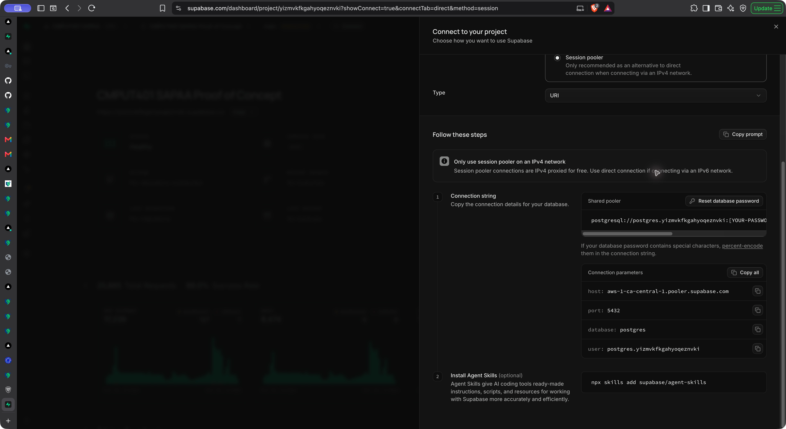
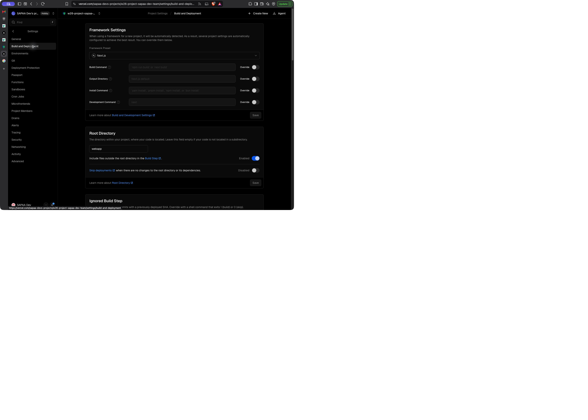
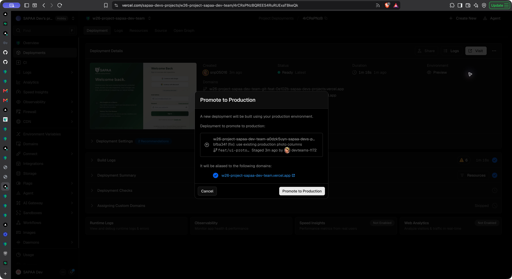
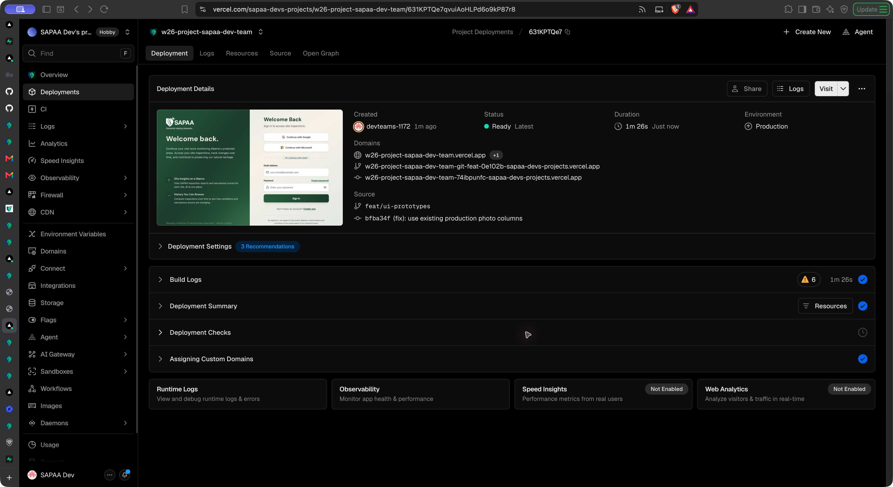

# SAPAA Dev production deployment

Verified on **October 31, 2026**. This guide describes the SAPAA Dev web app. It does not deploy StewardLog in `FNR/`.

## 1. Accounts, projects, and source

| Service | Account or project | Use |
| --- | --- | --- |
| Course GitHub | [UAlberta-CMPUT401/F26project-SAPAA](https://github.com/UAlberta-CMPUT401/F26project-SAPAA) | Course source, reviews, and documents |
| Deployment GitHub | [SAPAA-Dev/W26Project-SAPAA-Dev-Team](https://github.com/SAPAA-Dev/W26Project-SAPAA-Dev-Team) | Repository connected to the new Vercel project |
| Vercel | [sapaa-devs-projects / w26-project-sapaa-dev-team](https://vercel.com/sapaa-devs-projects/w26-project-sapaa-dev-team) | Builds and production releases |
| Team service email | `devteams@sapaastewards.com` | Team service account; use the team's approved sign-in method |
| Supabase organization | `CMPUT401 SAPAA` | Database and authentication management |
| Supabase project | [CMPUT401 SAPAA Proof of Concept](https://supabase.com/dashboard/project/yizmvkfkgahyoqeznvki) | The shared production database, Auth, and Storage |
| Protomaps | `devteams@sapaastewards.com` | Production map key, named **SAPAA Dev production** |
| Production website | [w26-project-sapaa-dev-team.vercel.app](https://w26-project-sapaa-dev-team.vercel.app) | Stable user address |

GitHub organizations are not shared login usernames. Sign in with your own GitHub account that has repository access. Supabase organization membership, Vercel membership, and app admin approval are separate permissions.

The new UI is on **`feat/ui-prototypes`** in both repositories. Course `main` and `sprint-4` were merged into that branch. At this check, Vercel's automatic Production branch was still **`main`**. Releases of the new UI use a manual promotion from `feat/ui-prototypes`.

**A push to the course repository alone does not update the SAPAA Dev app.** Push the tested commit to the deployment repository, then promote the matching deployment. A later automatic release from deployment `main` can replace a manually promoted release. Check the source commit on every release.

## 2. PostgreSQL usernames and connection details

These are connection names, not passwords. The app uses Supabase HTTPS APIs with its server and public keys. It does **not** need a direct PostgreSQL password in Vercel for the current web app.

| Connection | Host | Port | Database | Username |
| --- | --- | --- | --- | --- |
| Direct | `db.yizmvkfkgahyoqeznvki.supabase.co` | `5432` | `postgres` | `postgres` |
| Session pooler | `aws-1-ca-central-1.pooler.supabase.com` | `5432` | `postgres` | `postgres.yizmvkfkgahyoqeznvki` |

The direct connection uses IPv6 by default. The session pooler supports IPv4. These values were read from **Connect → Direct → Connection Method** in the project dashboard. Recheck that page before use because service settings can change. See [Supabase connection documentation](https://supabase.com/docs/guides/database/connecting-to-postgres).

1. Open the Supabase project above.
2. Select **Connect** at the top of the project page.
3. Select **Direct / Connection string**.
4. Select **Direct connection** or **Session pooler** for your network.
5. Read the **Connection parameters**: host, port, database, and user.
6. Obtain the database password from the team's approved credential store or project owner. `[YOUR-PASSWORD]` in the dashboard is a placeholder. A Supabase login password, an app password, and the database password are different credentials.
7. Use SSL. Do not paste a password into a shell command, screenshot, chat, or Git commit.

Example read-only session. The password prompt keeps the password out of shell history:

```sh
psql "host=aws-1-ca-central-1.pooler.supabase.com port=5432 dbname=postgres user=postgres.yizmvkfkgahyoqeznvki sslmode=require" -W
```

Then check the connection without changing data:

```sql
BEGIN READ ONLY;
SELECT current_database(), current_user;
ROLLBACK;
```



There is **one live Supabase project**, with no staging database. A Preview website can still write to production. The web inspection tables (`form_responses`, `answers`, `questions`) differ from the legacy StewardLog tables. See [Software Design](software-design.md) and [Contributing](contributing.md).

## 3. Vercel build settings

Open the Vercel project → **Settings → Build and Deployment**.

| Setting | Verified value |
| --- | --- |
| Framework Preset | Next.js |
| Root Directory | `webapp` |
| Build Command | Framework default: `npm run build` / `next build` |
| Output Directory | Next.js default |
| Install Command | Framework default; no override enabled |
| Vercel Node.js Version | `24.x` |
| Course CI Node.js Version | `22` |

The Vercel and CI Node versions are different in the current setup. This guide records that difference; it does not change the team setting. Run the repository checks with Node 22 and confirm the Vercel build result before promotion.



Under **Settings → Git**, confirm the connected repository is **SAPAA-Dev/W26Project-SAPAA-Dev-Team**. Under the Production environment settings, check the automatic branch. Do not assume the displayed production deployment came from that branch: a manual promotion can use a different branch.

## 4. Environment variables

Open **Settings → Environment Variables**. Use the existing team credentials. Values are deliberately absent from this guide.

| Variable | Source | Exposure |
| --- | --- | --- |
| `NEXT_PUBLIC_SUPABASE_URL` | Supabase project API settings | Public project URL |
| `NEXT_PUBLIC_SUPABASE_PUBLISHABLE_KEY` | Supabase public API key | Public key; RLS still applies |
| `SUPABASE_SECRET` | Supabase server API key | Server only; bypasses RLS |
| `NEXT_PUBLIC_PROTOMAPS_API_KEY` | Protomaps account, **SAPAA Dev production** | Browser key, restricted by allowed origin |
| `AWS_ACCESS_KEY_ID` | Existing team AWS IAM credential | Server only |
| `AWS_SECRET_ACCESS_KEY` | Matching AWS credential | Server only |
| `AWS_REGION` | Region of the existing bucket | Server configuration |
| `AWS_S3_BUCKET_NAME` | Existing team bucket | Server configuration |

Check **Production** scope. Check **Preview** scope if previews use these integrations. Never add a secret with a `NEXT_PUBLIC_` prefix. AWS access key IDs are not AWS console login usernames. This release did not verify an AWS console username; obtain console access from the AWS account owner.

After a value changes, make a new deployment. Existing deployments keep their build configuration. Public Next.js values can be included at build time. See [Vercel environment variables](https://vercel.com/docs/environment-variables).

### Protomaps allowed website

The production key permits this exact origin:

```text
https://w26-project-sapaa-dev-team.vercel.app
```

The origin has no page path. A generated Preview address has a different origin, so the production-only key can reject its map requests. **Invalid origin for API key** means the key/origin combination is wrong; it does not mean MapLibre failed to load. Check the production address first. Do not remove origin restrictions to make a preview work. Use an approved preview key or approved allowed origin when needed.

## 5. Get and test the release source

Run from the repository root. The remote names below match the checked local repository: `origin` is the course repository; `upstream` is the deployment repository. The name `upstream` does not change what that remote points to.

```sh
git pull --ff-only
git status --short
git remote -v
git branch --show-current
git fetch origin
git fetch upstream
```

For this release, work on `feat/ui-prototypes`. Preserve unrelated local files. Do not force push or reset work to make a deployment easier.

Check that the intended course branches are included:

```sh
git merge-base --is-ancestor origin/main HEAD
git merge-base --is-ancestor origin/sprint-4 HEAD
git log -5 --oneline
```

Exit code zero means the named branch is an ancestor. If a check fails, integrate and review the missing changes before release. Do not copy selected map files without their shared parsers, authorization checks, tests, and API callers.

Run the web checks:

```sh
cd webapp
npm ci --ignore-scripts
npx tsc --noEmit
npm run test:ci
npm run lint -- --max-warnings 0 --ignore-pattern 'coverage/**'
npm run build
```

The build needs environment values. Use the approved local setup. CI uses placeholder Supabase values for a compile check; that check does not prove live credentials work. Never run Cypress against this shared project: its tasks can change production rows. Do not run native builds or the Google Sheets script as release tests.

For documentation changes, run from the repository root:

```sh
mkdocs build --clean
```

The GitHub Pages documentation workflow runs on course `main`. A guide committed to a feature branch is readable in GitHub, but does not reach the published Pages site until the normal review and merge occur.

## 6. Push and promote the exact commit

1. Commit each logical change with the repository format, such as `(fix): preserve historic report dates`.
2. Run the required review and checks. Record the commit:

   ```sh
   git rev-parse HEAD
   git push origin HEAD
   git push upstream HEAD
   ```

3. Open the Vercel project → **Deployments**. Find the deployment from `feat/ui-prototypes` with that same commit. Wait for **Ready**. A successful push is not a successful deployment.
4. Open the deployment. Check **Source**, the branch, and the commit link. Read build logs if it failed.
5. Select **Deployment Actions → Promote to Production**.
6. In the review dialog, check the commit, branch, and stable production domain. Stop if any value is wrong.
7. Select **Promote to Production**. Complete Vercel's normal account verification if it appears. Do not put a verification code in project files.
8. Wait for the production deployment to show **Ready**. In this project, promoting a Preview produced a new Production build. Use the resulting Production deployment, not the old Preview status, as proof.
9. Check that **Domains** includes `w26-project-sapaa-dev-team.vercel.app` and that **Source** still has the intended commit.





The screenshots show the photo loading release `bfba34f9`. Later releases must show their own source commit. See [Vercel promotion documentation](https://vercel.com/docs/deployments/promoting-a-deployment).

## 7. Check the stable production website

Use the stable address, then reload the page. Check the release from an approved account.

- **Sites:** list loads, starts in Name (A–Z) order, and can sort Z–A. Search and filters still work.
- **Map:** Protomaps tiles load. Site pins, boundary details, search, and type/county/status filters load. Minus zooms outside Alberta. Expand and Restore preserve the map.
- **Mobile map:** controls fit a narrow screen. A selected site opens a compact panel; Details scrolls. Filter dialogs stay in the viewport. Clear all removes carried search and filters.
- **Boundary import:** an admin sees Upload KML/KMZ. A steward does not. Do not import a sample into production as a test. The feature uses private Supabase staging storage, parses the file, upserts `protected_areas`, and links sites. It does not need a bundled boundary file.
- **Reports:** open an existing report. Open Edit without saving and check that the visit date and answers match. New reports still show required fields. Use mocked tests for writes unless the owner has approved a real correction.
- **Photos:** the gallery and a site's photos load. Check that actual image pixels load, not only captions. An admin or owner sees Edit photo details. Delete remains admin-only.
- **Accounts:** approved users can sign in. Test admin and steward views with the correct role. Signing out must not expose the previous account's cached data.
- **Logs:** check Vercel runtime logs for failed API calls. An empty gallery and a failed gallery are different results.

Record the production deployment URL, source commit, checked pages, and limits of the check. A desktop phone emulator does not prove behavior on a physical iPhone.

## 8. Photos and S3 troubleshooting

The photo flow has three separate steps: read metadata from PostgreSQL, sign a URL on the server, then load or upload the S3 object. Check the failed step before changing credentials.

| Symptom | First check | Action |
| --- | --- | --- |
| Photos did not load; `/api/v1/photos` returns 500 | Vercel runtime logs | Read the server error before changing S3 settings |
| `column attachments.created_at does not exist` | Photo query projection | Use the production-supported photo columns. Release `bfba34f9` removes that column and uses photo/report dates. No database change is needed |
| Captions load but image requests fail | Browser Network panel, image GET | Check expired signed URLs, AWS region, credential permissions, key path, and object existence |
| Upload fails before S3 request | `/api/s3/presign` or `/api/s3/presign-homepage-images` | Check approved session, allowed file size/type, and report ownership |
| Browser upload fails at OPTIONS/PUT | S3 CORS and response | Check the exact production origin and required upload method/headers in the existing bucket configuration |
| Old signed URL stops working | URL age | Reload to obtain a new URL; do not commit signed URLs |

The production gallery fix was checked with real existing S3 images. No new photo or boundary dataset was uploaded for that check. This does not verify every upload path or bucket permission.

## 9. Cache and performance checks

The v2 client reuses recent reads for 30 seconds and joins matching requests already in progress. Writes invalidate the affected photo/site/report reads. Old in-flight responses cannot replace a newer result after invalidation. Account changes discard private client state. Report form navigation requests fresh reads on return.

Profile history reuses page one from `/api/profile`; later pages use the history API. Profile summary reads run together. The map loads its code and map data together; changing only selection reuses the filtered site array.

For a repeatable browser check, use Brave Developer Tools → Performance. Record a reload at the same viewport and network/CPU settings. Compare LCP, layout shift, interaction time, and API requests. Repeat cold and warm loads. Do not treat one warm desktop measurement as field performance on a phone. Do not cache authenticated data publicly to improve a score.

## 10. Roll back a release

1. Record the failing production deployment and source commit.
2. In Vercel Deployments, open the last verified **Production** deployment.
3. Use the rollback action, or promote that verified release through the available project flow.
4. Verify the stable domain, source commit, and affected pages again.
5. Keep the failing commit for diagnosis; do not rewrite shared Git history.

A code rollback does not undo database writes, account changes, file uploads, or schema changes. This release uses existing tables and does not require a production migration. Proposed future SQL changes need human review and application under the repository database rules.
