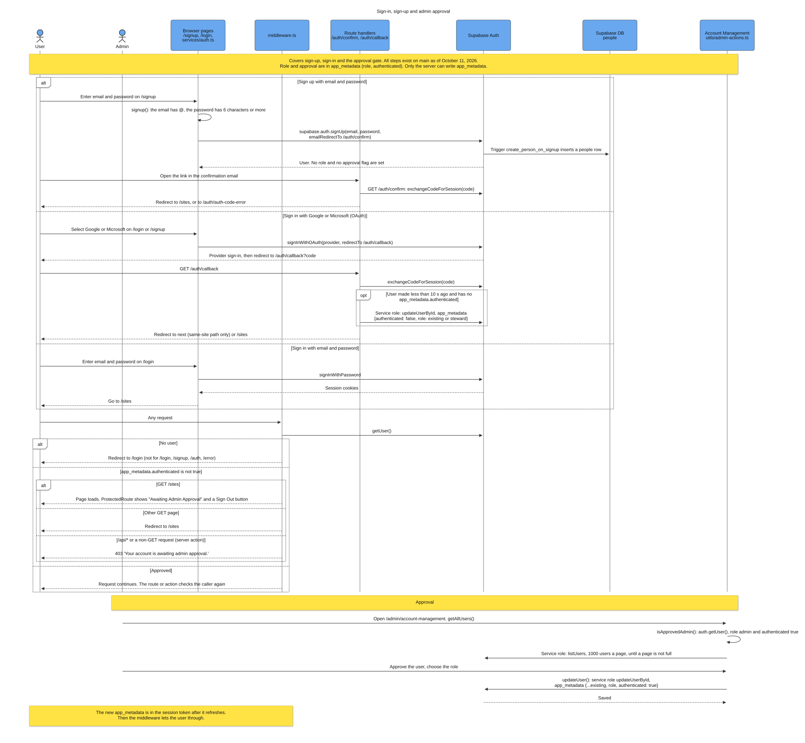
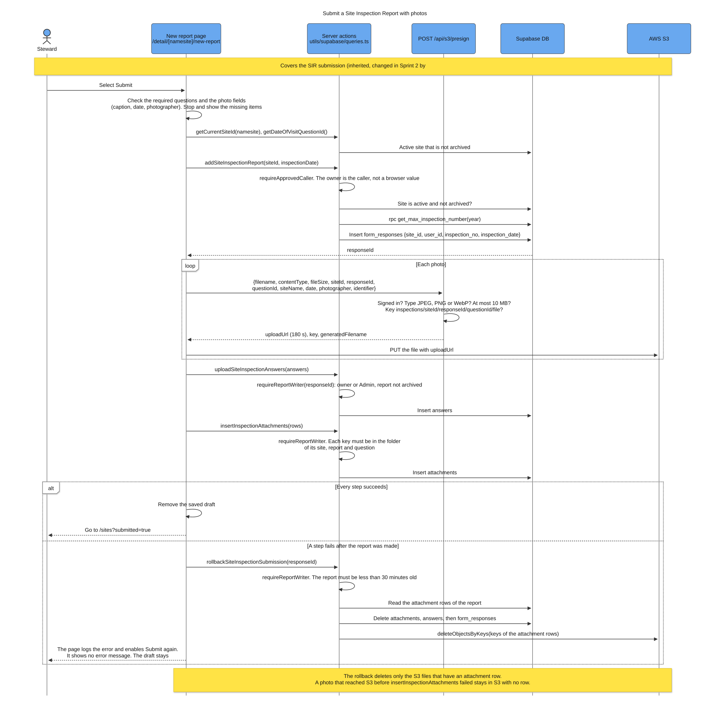
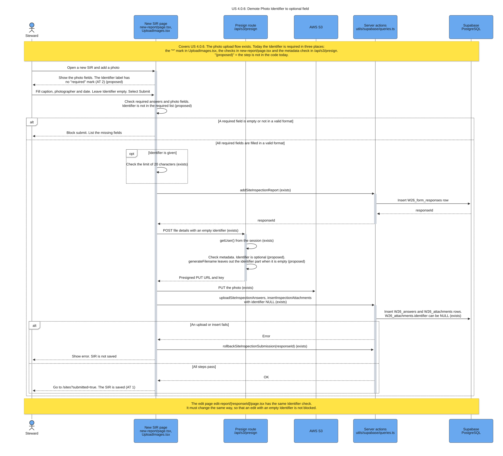

# Software Design

This page shows the high-level design of the SAPAA system: the architecture, the data, the key interactions, the user interface, and the technologies. The diagrams mark the parts that are proposed. The other parts show the code on `main` as of October 13, 2026 (ceb5188), the Sprint 2 release, merged in [#284](https://github.com/UAlberta-CMPUT401/F26project-SAPAA/pull/284). A proposed part does not exist in the code. It is a design proposal for a user story, not a decision.

### How the diagrams are generated

Each diagram has a Mermaid source in `docs/assets/` and a rendered SVG in `docs/images/`. Run `npm run diagrams` from the repository root to update them. The tool in `tools/diagrams/` does these steps:

1. It makes the current schema from the migrations in `webapp/supabase/migrations/` and writes the generated part of the ER diagram and of the data model diagram.
2. It reads the exported functions and route handlers of the web app and writes the generated part of the services diagram.
3. It warns when a hand-written diagram names a table or a column that a migration removed.
4. It renders each source that changed to SVG.

The tool changes only the text between the `%% BEGIN GENERATED` and `%% END GENERATED` markers. All other text in a source is hand-written. On each pull request to `main` or `release`, a workflow runs the tool and commits the changes to the pull request branch. See [Contributing: Diagrams](contributing.md#diagrams).

---

## Architecture diagram

The diagram shows all the parts of the system and how they connect. Use it to find which part owns a feature before you change the code. The Winter 2026 diagram (`images/Architecture.png`) is not correct. It shows Prisma, Cybera RAC, and a React server that the mobile app calls. The code does not use them.

[Mermaid source](assets/Architecture.mmd)

[Open the diagram at full size](images/Architecture.svg)

The legend in the diagram explains the shapes. A rectangle is a component in this repository. A cylinder is a data store. A hexagon is an external service. A dashed shape or a dashed arrow is proposed. An arrow label tells the data or the call.

The system has five layers:

1. **Client layer.** Admins and stewards use the web app in a browser. Stewards use the StewardLog mobile app (`FNR/`). The mobile app keeps an offline copy of site data in expo-sqlite (`FNR/src/services/database.ts`). The Google Sheets script (`googleSheets/code.gs`) was removed from the repository in c7f7cb4 (#118).
2. **Application layer.** The Next.js web app (`webapp/`) runs on Vercel. `webapp/middleware.ts` refreshes the session and sends a signed-out user to `/login`. It also blocks a user that an admin has not approved: that user can load only `/sites`, which shows the "Awaiting Admin Approval" screen. Other pages redirect to `/sites`, and an API call or a server action gets 403 (#238, #240). See [API Documentation: Middleware](api-documentation.md#middleware). Pages and server actions call Supabase with supabase-js (`webapp/utils/supabase/`). The server actions include the steward assignment (`webapp/utils/steward-actions.ts`) and the KML import (`webapp/utils/kml-import-actions.ts`). API route handlers (`webapp/app/api/`) make presigned S3 URLs, delete images, return the profile data, call the OpenCage API, and start the PDF job (`webapp/lib/pdf/processPdfJob.ts`). The mobile app has no server of its own. It calls Supabase directly.
3. **Data and storage layer.** One Supabase project holds the PostgreSQL database, Supabase Auth, the private Storage bucket `kml-imports` for KML uploads, and three Edge Functions (`get-users`, `add-user`, `delete-user`) that the mobile admin screens call (`FNR/src/services/adminAuth.ts`). The source of the Edge Functions is not in this repository. An AWS S3 bucket holds inspection photos and PDF files. The browser uploads a photo directly to S3 with a presigned URL. See [Media Storage Architecture](aws-architecture.md).
4. **External services.** Supabase Auth signs users in with Google, Microsoft Azure, and GitHub OAuth (`webapp/services/auth.ts`, `webapp/app/login/actions.ts`, `FNR/src/services/auth.ts`). The web app and the mobile app get coordinates from the OpenCage Geocoding API. The site map (`webapp/components/map/SiteMap.tsx`) uses MapLibre GL with a Protomaps basemap style from `api.protomaps.com`. The Protomaps key is in `NEXT_PUBLIC_PROTOMAPS_API_KEY`. The heat map on the admin dashboard still uses Leaflet with OpenStreetMap tiles. The mobile map shows a Google My Maps embed. The iNaturalist API is proposed for US 4.0.5 and US 4.0.7.
5. **Build and documentation tooling.** GitHub Actions runs the Jest tests, the hook tests, and the MkDocs build on each push (`.github/workflows/ci.yaml`). On each pull request, it runs the PR checks, the labeler, the reviewer gate, and the diagram update (`.github/workflows/diagrams.yaml`). On a push to `main`, it publishes this site to GitHub Pages (`.github/workflows/gh-pages.yaml`).

---

## AWS architecture

For details about how images are stored and retrieved, see the
[Media Storage Architecture](aws-architecture.md).

---

## Interfaces

The system has four kinds of interface. Each page of the web app calls a server action in `webapp/utils/` for most reads and writes. An admin server action checks the caller on the server before it creates the service-role client. The report write actions check that the caller owns the report or is an admin. The read actions in `queries.ts` check for an approved caller (GitHub #251), so no exported read in `queries.ts` is left without a caller check. The service-role reads that only the PDF job needs live in `webapp/lib/pdf/reportQueries.ts`, a server-only module that is not a server action, so the browser cannot call them (GitHub #268, see [API Documentation](api-documentation.md#2-server-actions)). An action calls Supabase with supabase-js. Some actions call a SQL function with `supabase.rpc`, so that a count or a change runs in one transaction. An API route handler in `webapp/app/api/` serves the calls that a server action does not fit: the profile, the image lists and the image delete, the PDF job, the geocoder, the heat map and the presigned S3 URLs. The browser then sends a photo straight to S3 with the presigned URL. The mobile app skips this layer and calls Supabase directly.

| Interface | Where it is documented |
| --- | --- |
| API routes and server actions, with inputs, outputs, errors and the caller check of each | [API Documentation](api-documentation.md) |
| Who can read and write each table and bucket (row level security, by role) | [Access matrix](api-documentation.md#4-access-matrix) |
| SQL functions (RPC), with parameters, return value, security and grants | [Database RPC functions](api-documentation.md#3-database-rpc-functions) |
| Tables, columns and row level security of profiles, stewards and contact details | [User Model](user-model.md) |
| Route handlers with an OpenAPI description, tried out in the browser | `/api-docs` (Swagger), from `webapp/lib/swagger.ts`. It lists every route under `/api`. |
| Images and PDF files in S3 | [Media Storage Architecture](aws-architecture.md) |

The [UML class diagram](#uml-class-diagram) lists the exported server actions that the generator finds in the code.

---

## Design decisions

### Delete: archive by default and an admin hard delete

Deleting a site (US 2.0.4) archives it. `archiveSite` sets `sites_pa.archived_at`. The site then disappears from every list, and an admin can bring it back with `restoreSite`. Its reports, answers, images and steward assignment are not changed. An admin can also delete an archived site for good with `permanentlyDeleteSite`. That removes the `sites_pa` row. The reports, attachments and homepage images stay in the database with no site. The steward assignment and the site's links (`site_page_fields` rows) go with the row, because of `ON DELETE CASCADE`. The server action and RPC details are in [API Documentation](api-documentation.md#delete-behavior).

The two levels come from two pieces of advice:

- The TA advised that we do not delete site data, and that we mark a site as deleted and hide it, so that the client keeps the data ([TA lab notes](meetings/week5/Meeting_Notes.md), week 5). Archive is that default.
- The client asked for more than one level. On October 2 he asked for two or three levels when deleting a report: "suppress, archive, nuke" ([Oct 2 meeting](<meetings/week5/2026_10_02 _meeting_Frank.txt>), lines 975 to 982). On October 9 the team showed two levels, an archive that hides and can be restored and a delete for good that keeps the reports and photos. He answered "Make it happen" ([Oct 9 meeting](meetings/week6/2026_10_09_meeting_frank.txt), lines 425 to 434).

We kept the hard delete next to the archive for these reasons:

- The user story asks for a way to remove incorrect or duplicate site information (US 2.0.4). Only a hard delete does that. This is the "nuke" level of the client's request.
- The hard delete cannot run by accident. It works only on a site that is already archived, and the admin sees the count of connected records before each step (US 2.0.4 AT2).
- The hard delete does not remove inspection data. It only disconnects it, so it follows the TA's point that the client keeps the data. Only a report delete (US 7.0.8) removes inspection data, and that also needs an archive first.

We did not build a separate suppress level. The team notes call it redundant, and deactivating a site (US 2.0.3) already hides it from stewards.

### Won't Have: audio recordings on a SIR (US 7.0.9)

US 7.0.9 (record audio during a site inspection and play it back) is Won't Have for Fall 2026 (see [Project Management](project-management.md)). It has no design in this document and no table, route or diagram. If a later team builds it, the existing photo flow is the nearest pattern: a presigned S3 upload in a folder of the report, a row that links the file to `form_responses`, the owner-or-admin check of `requireReportWriter`, and the S3 cleanup on report rollback and permanent delete.

---

## Database schema (ER diagrams)

The ER diagrams show the tables, the columns, and the relations in the database. They show which data each app owns, and where the two inspection systems do not share data. This is important before a change to a query or to the schema.

One Supabase database holds two inspection systems. The web app uses its own tables (for example `form_responses`, `sites_pa`, and `S26_pdf_jobs`). Sprint 2 added the user model (`people`, `site_stewards`, `socials`) and `protected_areas` for the KML import. The migration `20261003000000_remove_w26_prefix.sql` removed the `W26_` prefix from the table names. The mobile app (StewardLog) uses the legacy tables. The web app and the mobile app both read two legacy tables. The web app reads `luperson` to find if the email of the signed-in user belongs to a steward. It reads `sites_report_fnr_test` for the heat map on the admin dashboard (`webapp/app/api/heatmap/route.ts`). The two apps also call the same database functions for the dashboard charts (`get_naturalness_distribution` and `get_top_sites_distribution`). `luperson` is the only table that both apps use. Except for these shared tables and functions, inspection data that one system writes does not show in the other system.

The web app diagram is generated from `webapp/supabase/migrations/`. It shows each table and column that the migrations make. The legacy diagram shows only the tables and columns that the code reads or writes. A column type is "unknown" when the code does not show it.

### Current schema: web app

[Mermaid source](assets/ER_Diagram.mmd)

[Open the diagram at full size](images/ER_Diagram_mermaid.svg)

### Current schema: mobile app (legacy)

The Google Apps Script also used these tables until it was removed in c7f7cb4.

[Mermaid source](assets/ER_Diagram_Legacy.mmd)

[Open the diagram at full size](images/ER_Diagram_Legacy_mermaid.svg)

### Proposed schema for the user stories

This diagram shows the web app tables after the user stories on the [User Stories](user-stories.md) page. Each table is marked EXISTING or NEW. Each new table and column names the user story that needs it. The proposed items are a design proposal, not a decision. The open questions are in the comments of the Mermaid source.

[Mermaid source](assets/ER_Diagram_Proposed_User_Stories.mmd)

[Open the diagram at full size](images/ER_Diagram_Proposed_User_Stories.svg)

---

## UML class diagram

The class diagrams show the main code modules and data models, and the calls between them. They show where a user story adds a class or a member, before the code exists. The class diagram is in two parts. Part 1 shows the services of the web app and the mobile app, and the external systems that they call. Part 2 shows the data models. The class lists between the GENERATED markers come from the code and the migrations. A class with a `<<new x.y.z>>` stereotype is proposed. A member with the tag `[NEW x.y.z]` or `[CHANGE x.y.z]` is a proposed change for that user story. All other items exist in the code today.

### Part 1: Services

[Mermaid source](assets/UML_Class_Diagram.mmd)

[Open the diagram at full size](images/UML_Class_Diagram.svg)

### Part 2: Data models

[Mermaid source](assets/UML_Class_Diagram_Models.mmd)

[Open the diagram at full size](images/UML_Class_Diagram_Models.svg)

---

## Sequence diagrams

The sequence diagrams show the key interaction scenarios: the order of the calls between the user, the apps, Supabase, S3, and the external services. This makes clear which part does each step, and what each story adds to the code. Each diagram names the user stories that it covers. A step with "(proposed)" does not exist in the code today. The diagrams show the server-side permission checks that the user stories need. Some of these checks are not in the code today.

### Sign-in, sign-up and admin approval

Purpose: This diagram shows how a user signs up or signs in with a password or OAuth, how the middleware holds an unapproved user, and how an admin approves the account. Stories: the inherited sign-in flow, with the approval gate of #238 and #240.

[Mermaid source](assets/Sequence_Auth_Sign_In_Sign_Up_and_Admin_Approval.mmd)

[Open the diagram at full size](images/Sequence_Auth_Sign_In_Sign_Up_and_Admin_Approval.svg)

### Submit a Site Inspection Report with photos

Purpose: This diagram shows how the new-report page saves a SIR, its answers and its photos, which server check each step makes, and how a failed step rolls the report back. Stories: the inherited SIR submission, with the caller checks of #242 and the S3 cleanup of #148.

[Mermaid source](assets/Sequence_SIR_Submission_With_Photos.mmd)

[Open the diagram at full size](images/Sequence_SIR_Submission_With_Photos.svg)

### US 1.0.1, 1.0.3, 1.0.4: Add User Profiles / Show history of Site Inspections on a Steward's Profile / Aggregate User Activity and Contributions on a user's profile

Purpose: This diagram shows how a Steward opens a profile, and how the server gets the details, SIR history, and totals again on each load. Stories: US 1.0.1 – Add User Profiles, US 1.0.3 – Show history of Site Inspections on a Steward's Profile, US 1.0.4 – Aggregate User Activity and Contributions on a user's profile.

[Mermaid source](assets/Sequence_US_1_0_1_1_0_3_1_0_4_View_Steward_Profile.mmd)

[Open the diagram at full size](images/Sequence_US_1_0_1_1_0_3_1_0_4_View_Steward_Profile.svg)

### US 1.0.2: Allow Editing Own Profile

Purpose: This diagram shows how a Steward saves profile changes, and how the server checks the fields and changes only the profile of the signed-in user. Stories: US 1.0.2 – Allow Editing Own Profile.

[Mermaid source](assets/Sequence_US_1_0_2_Edit_Own_Profile.mmd)

[Open the diagram at full size](images/Sequence_US_1_0_2_Edit_Own_Profile.svg)

### US 1.0.5: Earn Points for Inspection Activity

Purpose: This diagram shows the proposed design for Sprint 4: the profile and a scoreboard show contribution metrics that the server calculates from the reports, with no points table. It follows the [Gamification proposal](user-model.md#gamification-proposal). Stories: US 1.0.5 – Earn Points for Inspection Activity.

[Mermaid source](assets/Sequence_US_1_0_5_Activity_Points.mmd)

[Open the diagram at full size](images/Sequence_US_1_0_5_Activity_Points.svg)

### US 2.0.1, 2.0.6: View Sites and Past Visits on an Interactive Map / Search and Filter Sites by County on the Map

Purpose: This diagram shows how the map draws each active Site from its stored boundary, and how a Steward filters and searches Sites in the browser. Stories: US 2.0.1 – View Sites and Past Visits on an Interactive Map, US 2.0.6 – Search and Filter Sites by County on the Map.

[Mermaid source](assets/Sequence_US_2_0_1_2_0_6_Site_Map_Search_and_Filter.mmd)

[Open the diagram at full size](images/Sequence_US_2_0_1_2_0_6_Site_Map_Search_and_Filter.svg)

### US 2.0.2: Allow Admins to Add New Sites

Purpose: This diagram shows how an Admin adds a Site with a boundary, and the checks for duplicate names, empty fields, and the Admin role. Stories: US 2.0.2 – Allow Admins to Add New Sites.

[Mermaid source](assets/Sequence_US_2_0_2_Add_Site.mmd)

[Open the diagram at full size](images/Sequence_US_2_0_2_Add_Site.svg)

### US 2.0.3, 2.0.5: Deactivate and Reactivate a Site / Update a Site

Purpose: This diagram shows how an Admin deactivates or reactivates a Site, and how an Admin edits a Site page and hides fields on it. Stories: US 2.0.3 – Deactivate and Reactivate a Site, US 2.0.5 – Update a Site.

[Mermaid source](assets/Sequence_US_2_0_3_2_0_5_Update_and_Deactivate_Site.mmd)

[Open the diagram at full size](images/Sequence_US_2_0_3_2_0_5_Update_and_Deactivate_Site.svg)

### US 2.0.4: Delete a Site

Purpose: This diagram shows how an Admin confirms and deletes a Site, and how one transaction keeps the data unchanged if a step fails. Stories: US 2.0.4 – Delete a Site.

[Mermaid source](assets/Sequence_US_2_0_4_Delete_Site.mmd)

[Open the diagram at full size](images/Sequence_US_2_0_4_Delete_Site.svg)

### US 2.0.8, 2.0.10: View a Site's Details From the Map / Add links to Site Page

Purpose: This diagram shows how the map and the Site page get the same Site details, and how the external links open in a new tab. Stories: US 2.0.8 – View a Site's Details From the Map, US 2.0.10 – Add links to Site Page.

[Mermaid source](assets/Sequence_US_2_0_8_2_0_10_Site_Details_From_Map.mmd)

[Open the diagram at full size](images/Sequence_US_2_0_8_2_0_10_Site_Details_From_Map.svg)

### US 2.0.9: Upload a GPX Track of a Site Visit

Purpose: This diagram shows how a Steward uploads a GPX file, and how the server checks the track and saves it only if it is valid. Stories: US 2.0.9 – Upload a GPX Track of a Site Visit.

[Mermaid source](assets/Sequence_US_2_0_9_GPX_Track_Upload.mmd)

[Open the diagram at full size](images/Sequence_US_2_0_9_GPX_Track_Upload.svg)

### US 2.0.11: Show Safety Information for a Site

Purpose: This diagram shows how a Steward sees the safety information of a Site, and how the server lets only an Admin change it. Stories: US 2.0.11 – Show Safety Information for a Site.

[Mermaid source](assets/Sequence_US_2_0_11_Site_Safety_Information.mmd)

[Open the diagram at full size](images/Sequence_US_2_0_11_Site_Safety_Information.svg)

### US 2.0.12, 2.0.13: Score a Site for To-Visit Priority / Flag Site Points That Are a Year Old

Purpose: This diagram shows how an Admin saves the three scores, and how the server calculates the priority and gives the one-year reminder only to Admins. Stories: US 2.0.12 – Score a Site for To-Visit Priority, US 2.0.13 – Flag Site Points That Are a Year Old.

[Mermaid source](assets/Sequence_US_2_0_12_2_0_13_Site_Priority_Score.mmd)

[Open the diagram at full size](images/Sequence_US_2_0_12_2_0_13_Site_Priority_Score.svg)

### US 3.0.2: Steward Designation

Purpose: This diagram shows how an Admin finds and assigns a Steward to a Site, and how the Site page and the profile show the assignment. Stories: US 3.0.2 – Steward Designation.

[Mermaid source](assets/Sequence_US_3_0_2_Steward_Designation.mmd)

[Open the diagram at full size](images/Sequence_US_3_0_2_Steward_Designation.svg)

### US 3.0.3: Export all digital files from SIR-SAPAA

Purpose: This diagram shows how an Admin starts a background job that puts all images and other stored files in one ZIP file for download. Stories: US 3.0.3 – Export all digital files from SIR-SAPAA.

[Mermaid source](assets/Sequence_US_3_0_3_Export_All_Digital_Files.mmd)

[Open the diagram at full size](images/Sequence_US_3_0_3_Export_All_Digital_Files.svg)

### US 4.0.2: Offline and Online Map Layers

Purpose: This diagram shows how the web map downloads tiles for an area, and when it uses live tiles, cached tiles, or a "not downloaded" mark. Stories: US 4.0.2 – Offline and Online Map Layers.

[Mermaid source](assets/Sequence_US_4_0_2_Offline_and_Online_Map_Layers.mmd)

[Open the diagram at full size](images/Sequence_US_4_0_2_Offline_and_Online_Map_Layers.svg)

### US 4.0.4: Edit My Previous Inspections

Purpose: This diagram shows how a Steward changes the answers of their own SIR, and how the system refuses other users and empty required answers. Stories: US 4.0.4 – Edit My Previous Inspections.

[Mermaid source](assets/Sequence_US_4_0_4_Edit_My_Previous_Inspections.mmd)

[Open the diagram at full size](images/Sequence_US_4_0_4_Edit_My_Previous_Inspections.svg)

### US 4.0.5: iNaturalist integration

Purpose: This diagram shows how a Steward adds iNaturalist photos to a SIR, and how the app fills the Identifier and copies each photo to S3. Stories: US 4.0.5 – iNaturalist integration.

[Mermaid source](assets/Sequence_US_4_0_5_iNaturalist_Photo_Import.mmd)

[Open the diagram at full size](images/Sequence_US_4_0_5_iNaturalist_Photo_Import.svg)

### US 4.0.6: Demote Photo Identifier to optional field

Purpose: This diagram shows how a Steward submits a SIR photo with no Identifier, and the checks that require it in the code today. Stories: US 4.0.6 – Demote Photo Identifier to optional field.

[Mermaid source](assets/Sequence_US_4_0_6_Photo_Identifier_Optional.mmd)

[Open the diagram at full size](images/Sequence_US_4_0_6_Photo_Identifier_Optional.svg)

### US 4.0.7: Show the Top iNaturalist Observations for a Site

Purpose: This diagram shows how the Site page gets at most 5 popular iNaturalist observations for the area of the Site, with no iNaturalist account. Stories: US 4.0.7 – Show the Top iNaturalist Observations for a Site.

[Mermaid source](assets/Sequence_US_4_0_7_Top_iNaturalist_Observations.mmd)

[Open the diagram at full size](images/Sequence_US_4_0_7_Top_iNaturalist_Observations.svg)

### US 5.0.2, 5.0.4: Reset a Forgotten Password / Sign Out Properly

Purpose: This diagram shows how a user resets a password with an email code and no Admin, and how sign-out ends the session on the server. Stories: US 5.0.2 – Reset a Forgotten Password, US 5.0.4 – Sign Out Properly.

[Mermaid source](assets/Sequence_US_5_0_2_5_0_4_Password_Reset_and_Sign_Out.mmd)

[Open the diagram at full size](images/Sequence_US_5_0_2_5_0_4_Password_Reset_and_Sign_Out.svg)

### US 6.0.1: Store Each Site's Geometry From the Shared Source

Purpose: This diagram shows how a load job copies the Site boundaries from the shared Alberta KML, and lists the Sites with no boundary for an Admin. Stories: US 6.0.1 – Store Each Site's Geometry From the Shared Source.

[Mermaid source](assets/Sequence_US_6_0_1_Site_Geometry_Load.mmd)

[Open the diagram at full size](images/Sequence_US_6_0_1_Site_Geometry_Load.svg)

### US 7.0.1: Let Stewards Export Their Own Reports

Purpose: This diagram shows how a Steward exports their own SIR as a PDF with photos, and how the server refuses the SIRs of other users. Stories: US 7.0.1 – Let Stewards Export Their Own Reports.

[Mermaid source](assets/Sequence_US_7_0_1_Steward_PDF_Export.mmd)

[Open the diagram at full size](images/Sequence_US_7_0_1_Steward_PDF_Export.svg)

### US 7.0.3, 7.0.4: See All Inspections in One View / Compare One Question Across Years

Purpose: This diagram shows how an Admin gets SIR totals for a date range, and how a Steward compares the answers to one question across years. Stories: US 7.0.3 – See All Inspections in One View, US 7.0.4 – Compare One Question Across Years.

[Mermaid source](assets/Sequence_US_7_0_3_7_0_4_Inspection_Summaries.mmd)

[Open the diagram at full size](images/Sequence_US_7_0_3_7_0_4_Inspection_Summaries.svg)

### US 7.0.5: Delete an Image and Clean Up After It

Purpose: This diagram shows how an Admin deletes an image and its S3 file, and how SIR deactivation keeps the files but a rollback removes them. Stories: US 7.0.5 – Delete an Image and Clean Up After It.

[Mermaid source](assets/Sequence_US_7_0_5_Image_Delete_and_Cleanup.mmd)

[Open the diagram at full size](images/Sequence_US_7_0_5_Image_Delete_and_Cleanup.svg)

### US 7.0.6, 7.0.7: Export More Than 50 Site Inspection Reports / Hide Fields on a SIR Before Export

Purpose: This diagram shows how a background job exports more than 50 SIRs for an Admin, removes the hidden fields, and keeps the stored SIRs unchanged. Stories: US 7.0.6 – Export More Than 50 Site Inspection Reports, US 7.0.7 – Hide Fields on a SIR Before Export.

[Mermaid source](assets/Sequence_US_7_0_6_7_0_7_Bulk_SIR_Export_With_Hidden_Fields.mmd)

[Open the diagram at full size](images/Sequence_US_7_0_6_7_0_7_Bulk_SIR_Export_With_Hidden_Fields.svg)

### US 7.0.8: Delete a Site Inspection Report

Purpose: This diagram shows how an Admin deletes a SIR in one transaction that changes nothing on failure, and how the server then deletes its images. Stories: US 7.0.8 – Delete a Site Inspection Report.

[Mermaid source](assets/Sequence_US_7_0_8_Delete_SIR.mmd)

[Open the diagram at full size](images/Sequence_US_7_0_8_Delete_SIR.svg)

---

## Low-fidelity user interface

The wireframes show the Fall 2026 screens and the navigation between them. They let the client check the layout and the flow before we write the code. The final design can change.

### Fall 2026 wireframe

### Interactive wireframe

The [interactive wireframe](interactive-wireframe/index.md) lets you click through the Fall 2026 screens in a browser.

### Winter 2026 (inherited)

The Winter 2026 team made these wireframes. They do not show the Fall 2026 user stories. See them [on Figma](https://www.figma.com/design/8WLN54CokqHyoJHdGFY6kd/SAPAA-UI?node-id=0-1&p=f&t=dd9Or2IMUNQLwult-0).

---

## List of technologies used

The versions are the major versions in `webapp/package.json` and `FNR/package.json`.

### Web app (`webapp/`)

| Technology | What we use it for | Link |
| --- | --- | --- |
| Next.js 16 (App Router) | Web app framework: pages, server actions, API route handlers, middleware | [nextjs.org](https://nextjs.org/docs) |
| React 19 | User interface components | [react.dev](https://react.dev/) |
| TypeScript 5 | Typed JavaScript for the web app and the mobile app | [typescriptlang.org](https://www.typescriptlang.org/docs/) |
| MUI 7 and Emotion | User interface components and styles | [mui.com](https://mui.com/material-ui/) |
| Tailwind CSS 4 | Utility CSS classes | [tailwindcss.com](https://tailwindcss.com/docs) |
| MapLibre GL 6 | Site map with the protected area boundaries (`webapp/components/map/SiteMap.tsx`, #159) | [maplibre.org](https://maplibre.org/maplibre-gl-js/docs/) |
| Leaflet 1, React Leaflet 5, leaflet.heat | Heat map on the admin dashboard | [leafletjs.com](https://leafletjs.com/), [react-leaflet.js.org](https://react-leaflet.js.org/) |
| Chart.js 4 and react-chartjs-2 | Charts on the admin dashboard | [chartjs.org](https://www.chartjs.org/docs/) |
| @react-pdf/renderer 4 | PDF export of site inspection reports | [react-pdf.org](https://react-pdf.org/) |
| supabase-js 2 and @supabase/ssr | Database queries and sign-in with session cookies | [supabase.com/docs/reference/javascript](https://supabase.com/docs/reference/javascript/introduction) |
| AWS SDK for JavaScript 3 (client-s3, s3-request-presigner) | Presigned URLs to upload and show photos and PDF files | [AWS SDK v3](https://docs.aws.amazon.com/AWSJavaScriptSDK/v3/latest/) |
| dnd-kit | Drag and drop to sort items | [dndkit.com](https://dndkit.com/) |
| React Joyride 2 | Guided tour of the user interface | [react-joyride.com](https://react-joyride.com/) |
| react-markdown 10, remark-gfm, rehype-raw | Show Markdown text | [react-markdown](https://github.com/remarkjs/react-markdown) |
| next-swagger-doc and swagger-ui-react 5 | OpenAPI page for the API routes (`/api-docs`) | [swagger.io](https://swagger.io/tools/swagger-ui/) |
| lucide-react, react-icons | Icons | [lucide.dev](https://lucide.dev/), [react-icons](https://react-icons.github.io/react-icons/) |

### Mobile app StewardLog (`FNR/`)

The Fall 2025 team built the mobile app. The Winter 2026 team made small changes to it, for example to the sign-in code in `FNR/src/services/auth.ts`.

| Technology | What we use it for | Link |
| --- | --- | --- |
| Expo 54 | Build and run the React Native app | [docs.expo.dev](https://docs.expo.dev/) |
| React Native 0.81 | Mobile user interface for iOS and Android | [reactnative.dev](https://reactnative.dev/docs/getting-started) |
| React Navigation 7 | Screen navigation (stack and bottom tabs) | [reactnavigation.org](https://reactnavigation.org/) |
| React Native Paper 5 | User interface components | [reactnativepaper.com](https://reactnativepaper.com/) |
| expo-sqlite 16 | Offline copy of site and inspection data | [expo-sqlite](https://docs.expo.dev/versions/latest/sdk/sqlite/) |
| supabase-js 2 | Database queries and sign-in | [supabase.com/docs](https://supabase.com/docs/reference/javascript/introduction) |
| expo-auth-session, expo-web-browser | OAuth sign-in in the browser | [expo-auth-session](https://docs.expo.dev/versions/latest/sdk/auth-session/) |
| expo-secure-store, AsyncStorage | Store the session and settings on the device | [expo-secure-store](https://docs.expo.dev/versions/latest/sdk/securestore/) |
| @react-native-community/netinfo | Find if the device is online | [netinfo](https://github.com/react-native-netinfo/react-native-netinfo) |
| react-native-maps | Map of sites on the dashboard | [react-native-maps](https://github.com/react-native-maps/react-native-maps) |
| react-native-webview 13 | Show the Google My Maps embed and PDF.js | [react-native-webview](https://github.com/react-native-webview/react-native-webview) |
| PDF.js (from cdnjs) | Show PDF reports in the app | [mozilla.github.io/pdf.js](https://mozilla.github.io/pdf.js/) |
| expo-print, expo-sharing | Make and share PDF reports | [expo-print](https://docs.expo.dev/versions/latest/sdk/print/) |
| react-native-chart-kit 6 | Charts on the analytics screen | [react-native-chart-kit](https://github.com/indiespirit/react-native-chart-kit) |

### Backend, data, and hosting

| Technology | What we use it for | Link |
| --- | --- | --- |
| Supabase | Hosted PostgreSQL, Auth, Storage, REST API, and Edge Functions | [supabase.com/docs](https://supabase.com/docs) |
| PostgreSQL | Relational database for all app data | [postgresql.org/docs](https://www.postgresql.org/docs/) |
| Amazon S3 | Storage for inspection photos and PDF files | [Amazon S3](https://docs.aws.amazon.com/AmazonS3/latest/userguide/Welcome.html) |
| AWS IAM | Access keys and policies for the S3 bucket | [AWS IAM](https://docs.aws.amazon.com/iam/) |
| AWS Budgets | Cost alerts for the AWS account | [AWS Budgets](https://docs.aws.amazon.com/cost-management/latest/userguide/budgets-managing-costs.html) |
| Vercel | Hosts the web app. See the [Deployment Manual](Deployment-manual.md). | [vercel.com/docs](https://vercel.com/docs) |

### External APIs

| Service | What we use it for | Link |
| --- | --- | --- |
| OpenCage Geocoding API | Coordinates from an address or a site name | [opencagedata.com/api](https://opencagedata.com/api) |
| Protomaps | Basemap style and tiles of the site map. It needs an API key in `NEXT_PUBLIC_PROTOMAPS_API_KEY`. | [protomaps.com](https://docs.protomaps.com/) |
| OpenStreetMap tiles | Base map of the heat map on the admin dashboard | [openstreetmap.org](https://www.openstreetmap.org/copyright) |
| Google My Maps | Map embed in the mobile app | [Google My Maps](https://www.google.com/maps/about/mymaps/) |
| Supabase Auth OAuth providers | Sign-in with Google, Microsoft Azure, and GitHub | [Supabase social login](https://supabase.com/docs/guides/auth/social-login) |
| iNaturalist API (proposed) | Photo import and top observations for US 4.0.5 and US 4.0.7. Not in the code today. | [api.inaturalist.org](https://api.inaturalist.org/v1/docs/) |

### Development, testing, and documentation tools

| Tool | What we use it for | Link |
| --- | --- | --- |
| Git and GitHub | Source control, pull requests, and issues | [docs.github.com](https://docs.github.com/) |
| Git hooks (`.githooks/`) | Check commit messages and branch names | [Contributing](contributing.md) |
| GitHub Actions | Run the Jest tests, the hook tests, and the MkDocs build on each push. Run the PR checks and the diagram update on each pull request. Publish the docs from `main`. | [GitHub Actions](https://docs.github.com/en/actions) |
| GitHub Pages | Hosts this documentation site | [GitHub Pages](https://docs.github.com/en/pages) |
| Jest 30, Testing Library, jest-expo | Unit and component tests in the web app and the mobile app | [jestjs.io](https://jestjs.io/) |
| Cypress 15 | End-to-end tests of the web app. CI does not run them, because they use live data. | [docs.cypress.io](https://docs.cypress.io/) |
| ESLint 9 (eslint-config-next) | Lint the web app | [eslint.org](https://eslint.org/docs/latest/) |
| Supabase CLI 2 | Run a local Supabase for development (`npm run dev` in `webapp/`) and hold migrations (`webapp/supabase/`) | [Supabase CLI](https://supabase.com/docs/guides/local-development/cli/getting-started) |
| MkDocs with Material for MkDocs | Build this documentation site | [squidfunk.github.io/mkdocs-material](https://squidfunk.github.io/mkdocs-material/) |
| Mermaid and mermaid-cli | Diagram sources (`docs/assets/*.mmd`) and SVG files | [mermaid.js.org](https://mermaid.js.org/) |
| libpg-query and ts-morph | Read the migrations and the TypeScript code to generate the diagrams (`tools/diagrams/`) | [libpg-query](https://github.com/launchql/libpg-query-node), [ts-morph](https://ts-morph.com/) |

### Not used

The Winter 2026 architecture diagram shows Prisma and Cybera RAC. The code does not use Prisma. The team discussed Cybera as a host, but it is not in use.
