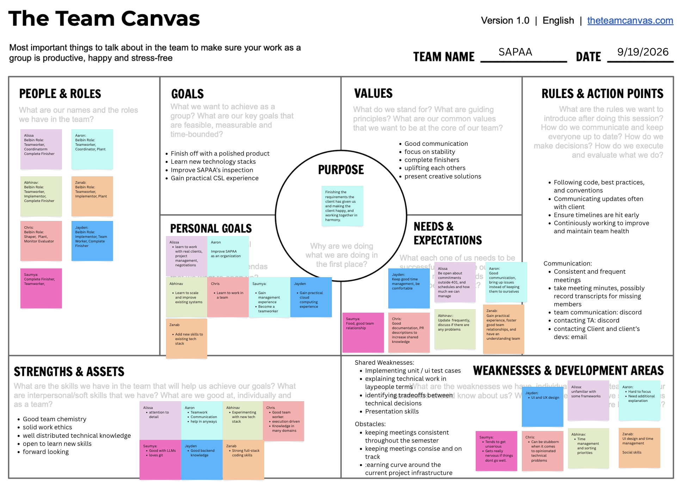

# Teamwork
This page gives an overview of the team and its members.

## Team Canvas

Select the image to open it at full size.

## Scrum Roles

The Scrum Master and the Product Owner change each sprint.

| Sprint | Scrum Master | Product Owner |
|--------|--------------|---------------|
| Sprint 1 | Chris | Alissa |
| Sprint 2 | Aaron | Chris |
| Sprint 3 | Jayden | Aaron |
| Sprint 4 | Abhinav | Zanab |
| Sprint 5 | Alissa | Abhinav |

The team decided at Meeting #0 (September 16, see [Meeting Minutes](meeting-minutes.md)) that the
roles rotate each sprint. Each sprint has a different pair, so 6 of the 7 members hold a role
during the term.

### Scrum Master

The Scrum Master runs the Scrum ceremonies, removes impediments and makes sure that the team follows the Scrum
principles.

### Product Owner

The Product Owner defines the product backlog items and sets their priority from customer needs and business value. The
Product Owner is the voice of the customer and makes sure that the development team builds a product that meets the
expectations of the customer.

### Sprint 2 role outputs

Only the work that GitHub or the minutes record is listed.

- **Scrum Master, Aaron.** Submitted reviews on 51 pull requests of other members, more than any
  other member. Committed the week 5 lab notes and the October 2 and October 9 client transcripts
  ([PR #126](https://github.com/UAlberta-CMPUT401/F26project-SAPAA/pull/126), [PR #127](https://github.com/UAlberta-CMPUT401/F26project-SAPAA/pull/127), [PR #168](https://github.com/UAlberta-CMPUT401/F26project-SAPAA/pull/168)). Owns the open action to get the TA's
  answer on DevOps stories (Meeting #8). From Sprint 3, the Scrum Master also reviews the
  `sprint-N` to `main` PR (see [Contributing](contributing.md#branch-model)).
- **Product Owner, Chris.** Submitted reviews on 40 pull requests of other members. Raised the
  Google Maps offline terms with Frank on October 2 and owned the release schedule recommendation,
  which the team discussed with Frank on October 9. Assigned to the Sprint 2 release notes
  ([#97](https://github.com/UAlberta-CMPUT401/F26project-SAPAA/issues/97)) and the demo and retrospective ([#98](https://github.com/UAlberta-CMPUT401/F26project-SAPAA/issues/98)), both open on October 11. The Sprint 2 and
  Sprint 3 backlog issues (50 and 51 issues) were written by Saumya, not by the Product Owner.

### Sprint 3 role outputs

Only the work that GitHub records is listed. Counts are for the PRs merged into `sprint-3`.

- **Scrum Master, Jayden.** Authored 2 merged PRs and submitted reviews on 9 PRs of other members, the third most. Is the assigned reviewer of the `sprint-3` to `main` PR (#319). That review is not recorded on the PR.
- **Product Owner, Aaron.** Authored 1 merged PR, submitted a review on 1 PR, and made 3 non-merge commits. Is assigned to the Sprint 3 release notes ([#217](https://github.com/UAlberta-CMPUT401/F26project-SAPAA/issues/217)) and the demo ([#218](https://github.com/UAlberta-CMPUT401/F26project-SAPAA/issues/218)); both are open on October 26. The Sprint 3 backlog issues were written by Saumya, not by the Product Owner.

## Sprint 3 contributions

This table covers October 14 to October 26, 2026. **Merged PRs** counts the 28 PRs merged into `sprint-3` by author (`gh pr list --base sprint-3 --state merged`). **Reviews** counts those PRs of other members on which the member submitted a review; the Copilot reviewer is not counted. **Commits** counts non-merge commits on `sprint-3` since October 14 (`git shortlog -sn --no-merges`). Work without a PR, such as client meetings and lab sessions, is not counted.

| Member | Team | Merged PRs | Reviews | Commits | Role |
|--------|------|-----------|---------|---------|------|
| Saumya | Red | 6 | 3 | 56 | None |
| Chris | Red | 7 | 16 | 31 | None |
| Alissa | Green | 4 | 2 | 16 | None |
| Abhinav | Blue | 6 | 13 | 8 | None |
| Jayden | Green | 2 | 9 | 7 | Scrum Master, Sprint 3 |
| Aaron | Blue | 1 | 1 | 3 | Product Owner, Sprint 3 |
| Zanab | Blue | 2 | 1 | 3 | None |

Saumya and Chris (Red) made 87 of the 124 commits. Red carried 47 of the 68 Sprint 3 points. The Product Owner and one other Blue member have the fewest commits and PRs. The load was uneven, and the team should say so.

**How the team handles it.** After the Sprint 3 review, the remaining work was split by area and assigned: Chris has [#323](https://github.com/UAlberta-CMPUT401/F26project-SAPAA/issues/323) and [#324](https://github.com/UAlberta-CMPUT401/F26project-SAPAA/issues/324), and Abhinav has [#325](https://github.com/UAlberta-CMPUT401/F26project-SAPAA/issues/325) and [#326](https://github.com/UAlberta-CMPUT401/F26project-SAPAA/issues/326). In Sprint 4 the Product Owner (Zanab) spreads the stories across the three teams (see [Project Management](project-management.md#re-estimate-after-sprint-3)).

## Sprint 2 contributions

This table counts the 71 pull requests merged after the Sprint 1 release (the `sprint-1` tag,
September 29, 2026, 5:15 PM MDT) up to the code freeze on October 11, 2026: 69 merged into `main`,
and 2 stacked PRs (#130, #134) that reached `main` through #129 and #133. The counts come from
`gh pr list --state merged`, `gh pr view` and the commit history. They do not include work that has
no pull request, such as the client meetings, the lab sessions and the pair work before a merge.

- **Coding** counts the pull requests that the member authored and that are not documentation. It includes CI,
  test-only and migration changes.
- **Testing** counts the coding pull requests that add or change a test file (`__tests__`, Cypress or `.test.`).
- **Reviews** counts the pull requests of other members on which the member submitted a review. The Copilot reviewer
  is not counted.
- **Documentation** counts the pull requests whose title starts with `(docs)`.
- **Issues** counts the GitHub issues that the member opened from September 30 to October 11.

| Member | Mini-team | Coding (PRs) | Testing | Reviews | Documentation | Issues | Management |
|--------|-----------|--------------|---------|---------|---------------|--------|------------|
| Saumya | Alpha | 28: user model migrations, steward server actions and profile links, `W26_` rename, CI reviewer gate and release branch checks, diagram generator, sign-out on every page, and the October 10 and 11 fixes (CI build and type check, map search, PDF export paging, auth gaps, caller checks, test labels) | 21 of 28 | 9 | 16: user model proposal, Oct 2 client deck and talk track, Sprint 2 status and Sprint 3 plan, minutes, interfaces, release runbook, diagrams, Oct 9 deck | 52: the Sprint 2 and Sprint 3 story and task issues | Oct 2 and Oct 9 client updates ([PR #122](https://github.com/UAlberta-CMPUT401/F26project-SAPAA/pull/122), [PR #123](https://github.com/UAlberta-CMPUT401/F26project-SAPAA/pull/123), [PR #250](https://github.com/UAlberta-CMPUT401/F26project-SAPAA/pull/250)) |
| Aaron | Alpha | 2: admin navigation on the site page, profile page with inspection history | 2 of 2 | 51 | 3: week 5 notes, Oct 2 and Oct 9 meeting transcripts | 0 | Scrum Master, Sprint 2 |
| Alissa | Beta | 4: field selection for PDF export, optional photo identifier, protected area map search, linking sites to protected areas | 4 of 4 | 9 | None merged | 0 | None recorded |
| Abhinav | Beta | 5: KML parser, mapping data in the database, Protomaps and MapLibre basemap, site boundaries, form keeps its section | 5 of 5 | 28 | 1: Oct 2 transcript file name | 0 | None recorded |
| Chris | Gamma | 4: release branch, `app_metadata` checks, image delete with local S3, steward PDF download | 3 of 4 | 40 | 1: removed the git co-author instruction from `AGENTS.md` | 0 | Product Owner, Sprint 2 |
| Jayden | Gamma | 3: admin view of inactive sites, archive and delete sites, archive and delete reports | 3 of 3 | 15 | None merged | 0 | None recorded. Assigned the code freeze issue ([#96](https://github.com/UAlberta-CMPUT401/F26project-SAPAA/issues/96)), open on October 11 |
| Zanab | Gamma | 4: site links, add a site, map area suggestions, show, hide and edit site page fields | 4 of 4 | 4 | None merged | 0 | None recorded |

Saumya authored 44 of the 71 pull requests, including all 17 that merged on October 10 and 11
(#234 to #250). Alissa, Jayden and Zanab have no merged documentation in Sprint 2.

### Merged pull requests by member

- **Saumya**: code [#119](https://github.com/UAlberta-CMPUT401/F26project-SAPAA/pull/119), [#124](https://github.com/UAlberta-CMPUT401/F26project-SAPAA/pull/124), [#125](https://github.com/UAlberta-CMPUT401/F26project-SAPAA/pull/125), [#128](https://github.com/UAlberta-CMPUT401/F26project-SAPAA/pull/128), [#129](https://github.com/UAlberta-CMPUT401/F26project-SAPAA/pull/129), [#131](https://github.com/UAlberta-CMPUT401/F26project-SAPAA/pull/131), [#132](https://github.com/UAlberta-CMPUT401/F26project-SAPAA/pull/132), [#133](https://github.com/UAlberta-CMPUT401/F26project-SAPAA/pull/133), [#134](https://github.com/UAlberta-CMPUT401/F26project-SAPAA/pull/134), [#139](https://github.com/UAlberta-CMPUT401/F26project-SAPAA/pull/139), [#140](https://github.com/UAlberta-CMPUT401/F26project-SAPAA/pull/140), [#141](https://github.com/UAlberta-CMPUT401/F26project-SAPAA/pull/141), [#142](https://github.com/UAlberta-CMPUT401/F26project-SAPAA/pull/142), [#151](https://github.com/UAlberta-CMPUT401/F26project-SAPAA/pull/151), [#154](https://github.com/UAlberta-CMPUT401/F26project-SAPAA/pull/154), [#157](https://github.com/UAlberta-CMPUT401/F26project-SAPAA/pull/157), [#158](https://github.com/UAlberta-CMPUT401/F26project-SAPAA/pull/158), [#234](https://github.com/UAlberta-CMPUT401/F26project-SAPAA/pull/234), [#235](https://github.com/UAlberta-CMPUT401/F26project-SAPAA/pull/235), [#236](https://github.com/UAlberta-CMPUT401/F26project-SAPAA/pull/236), [#237](https://github.com/UAlberta-CMPUT401/F26project-SAPAA/pull/237), [#238](https://github.com/UAlberta-CMPUT401/F26project-SAPAA/pull/238), [#239](https://github.com/UAlberta-CMPUT401/F26project-SAPAA/pull/239), [#240](https://github.com/UAlberta-CMPUT401/F26project-SAPAA/pull/240), [#241](https://github.com/UAlberta-CMPUT401/F26project-SAPAA/pull/241), [#242](https://github.com/UAlberta-CMPUT401/F26project-SAPAA/pull/242), [#243](https://github.com/UAlberta-CMPUT401/F26project-SAPAA/pull/243), [#249](https://github.com/UAlberta-CMPUT401/F26project-SAPAA/pull/249); documentation [#111](https://github.com/UAlberta-CMPUT401/F26project-SAPAA/pull/111), [#112](https://github.com/UAlberta-CMPUT401/F26project-SAPAA/pull/112), [#115](https://github.com/UAlberta-CMPUT401/F26project-SAPAA/pull/115), [#116](https://github.com/UAlberta-CMPUT401/F26project-SAPAA/pull/116), [#118](https://github.com/UAlberta-CMPUT401/F26project-SAPAA/pull/118), [#122](https://github.com/UAlberta-CMPUT401/F26project-SAPAA/pull/122), [#123](https://github.com/UAlberta-CMPUT401/F26project-SAPAA/pull/123), [#130](https://github.com/UAlberta-CMPUT401/F26project-SAPAA/pull/130), [#143](https://github.com/UAlberta-CMPUT401/F26project-SAPAA/pull/143), [#156](https://github.com/UAlberta-CMPUT401/F26project-SAPAA/pull/156), [#244](https://github.com/UAlberta-CMPUT401/F26project-SAPAA/pull/244), [#245](https://github.com/UAlberta-CMPUT401/F26project-SAPAA/pull/245), [#246](https://github.com/UAlberta-CMPUT401/F26project-SAPAA/pull/246), [#247](https://github.com/UAlberta-CMPUT401/F26project-SAPAA/pull/247), [#248](https://github.com/UAlberta-CMPUT401/F26project-SAPAA/pull/248), [#250](https://github.com/UAlberta-CMPUT401/F26project-SAPAA/pull/250).
- **Aaron**: code [#120](https://github.com/UAlberta-CMPUT401/F26project-SAPAA/pull/120), [#138](https://github.com/UAlberta-CMPUT401/F26project-SAPAA/pull/138); documentation [#126](https://github.com/UAlberta-CMPUT401/F26project-SAPAA/pull/126), [#127](https://github.com/UAlberta-CMPUT401/F26project-SAPAA/pull/127), [#168](https://github.com/UAlberta-CMPUT401/F26project-SAPAA/pull/168).
- **Alissa**: code [#146](https://github.com/UAlberta-CMPUT401/F26project-SAPAA/pull/146), [#147](https://github.com/UAlberta-CMPUT401/F26project-SAPAA/pull/147), [#166](https://github.com/UAlberta-CMPUT401/F26project-SAPAA/pull/166), [#167](https://github.com/UAlberta-CMPUT401/F26project-SAPAA/pull/167); documentation none.
- **Abhinav**: code [#137](https://github.com/UAlberta-CMPUT401/F26project-SAPAA/pull/137), [#152](https://github.com/UAlberta-CMPUT401/F26project-SAPAA/pull/152), [#159](https://github.com/UAlberta-CMPUT401/F26project-SAPAA/pull/159), [#161](https://github.com/UAlberta-CMPUT401/F26project-SAPAA/pull/161), [#164](https://github.com/UAlberta-CMPUT401/F26project-SAPAA/pull/164); documentation [#136](https://github.com/UAlberta-CMPUT401/F26project-SAPAA/pull/136).
- **Chris**: code [#121](https://github.com/UAlberta-CMPUT401/F26project-SAPAA/pull/121), [#144](https://github.com/UAlberta-CMPUT401/F26project-SAPAA/pull/144), [#148](https://github.com/UAlberta-CMPUT401/F26project-SAPAA/pull/148), [#155](https://github.com/UAlberta-CMPUT401/F26project-SAPAA/pull/155); documentation [#117](https://github.com/UAlberta-CMPUT401/F26project-SAPAA/pull/117).
- **Jayden**: code [#150](https://github.com/UAlberta-CMPUT401/F26project-SAPAA/pull/150), [#160](https://github.com/UAlberta-CMPUT401/F26project-SAPAA/pull/160), [#165](https://github.com/UAlberta-CMPUT401/F26project-SAPAA/pull/165); documentation none.
- **Zanab**: code [#145](https://github.com/UAlberta-CMPUT401/F26project-SAPAA/pull/145), [#153](https://github.com/UAlberta-CMPUT401/F26project-SAPAA/pull/153), [#162](https://github.com/UAlberta-CMPUT401/F26project-SAPAA/pull/162), [#163](https://github.com/UAlberta-CMPUT401/F26project-SAPAA/pull/163); documentation none.

## Belbin Roles
Source: [https://www.belbin.com/about/belbin-team-roles](https://www.belbin.com/about/belbin-team-roles)

| Name | Preferred Roles | Manageable Roles | Least Preferred Roles |
|------|-----------------|------------------|-----------------------|
| Chris | SH | PL | RI |
| Abhinav | TW | IMP | RI |
| Jayden | IMP | TW | SH |
| Saumya | CF | TW | SH |
| Aaron | CO | TW | ME |
| Alissa | TW | CO | PL |
| Zanab | TW | IMP | RI |

The lists below come from the table. Each list gives the members who have the role as a preferred role or as a
manageable role.

### Thinking Roles

#### PL (Plant)
> The Plant is creative and finds new solutions to difficult problems.

- Chris (manageable)

#### ME (Monitor Evaluator)
> The Monitor Evaluator examines all options with logic and makes impartial decisions.

- No member has this role as a preferred or manageable role.

#### SP (Specialist)
> The Specialist gives the team deep knowledge of one key area.

- No member has this role as a preferred or manageable role.

### Action Roles

#### SH (Shaper)
> The Shaper gives the team the drive to keep its focus and momentum when work is difficult.

- Chris (preferred)

#### IMP (Implementer)
> The Implementer changes ideas into a practical plan and does the plan efficiently.

- Jayden (preferred)
- Abhinav (manageable)
- Zanab (manageable)

#### CF (Completer Finisher)
> The Completer Finisher examines the work at the end of a task, finds errors and makes sure that the quality is high.

- Saumya (preferred)

### People Roles

#### RI (Resource Investigator)
> The Resource Investigator speaks with people outside the team to find information, ideas and help for the team.

- No member has this role as a preferred or manageable role.

#### TW (Teamworker)
> The Teamworker helps the team to work well together, listens to all members and supports them where necessary.

- Abhinav (preferred)
- Alissa (preferred)
- Zanab (preferred)
- Jayden (manageable)
- Saumya (manageable)
- Aaron (manageable)

#### CO (Coordinator)
> The Coordinator makes the team goals clear, gives tasks to the correct members and makes sure that all members know
> their part of the work.

- Aaron (preferred)
- Alissa (manageable)
