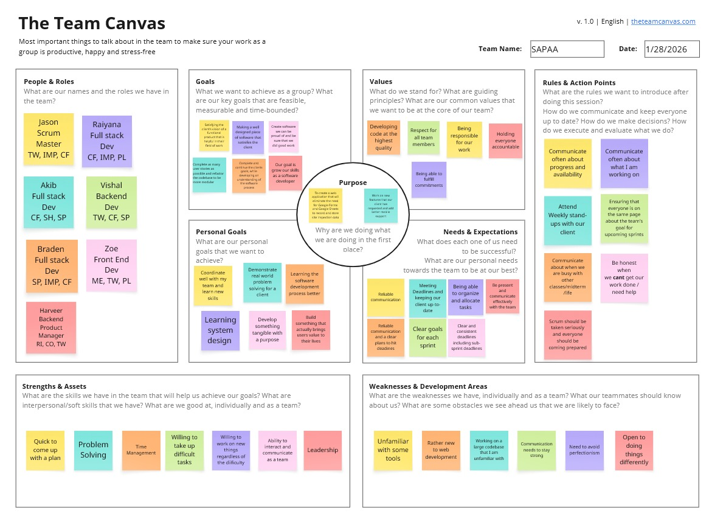

# Teamwork
This page provides an overview of the team and its members.

## Team Canvas

# Scrum Roles

## Scrum Master

**Role Description:**  
The Scrum Master is responsible for facilitating Scrum ceremonies, removing impediments, and ensuring that the team adheres to Scrum principles.

**Person Assigned:**

- **Sprint 1:** Chris
- **Sprint 2:** Aaron
- **Sprint 3:** Jayden
- **Sprint 4:** Abhinav
- **Sprint 5:** Alissa

---

## Product Owner

**Role Description:**  
The Product Owner defines and prioritizes the product backlog items based on customer needs and business value. They represent the voice of the customer, ensuring that the development team builds a product that meets expectations.

**Person Assigned:**

- **Sprint 1:** Alissa
- **Sprint 2:** Chris
- **Sprint 3:** Aaron
- **Sprint 4:** Zanab
- **Sprint 5:** Abhinav

## Belbin Roles
Source: [https://www.belbin.com/about/belbin-team-roles](https://www.belbin.com/about/belbin-team-roles)

|Name   |Preferred Roles |Manageable Roles |Least Preferred Roles |
|-------|----------------|------------------|-----------------------|
|Chris  |SH             |PL               |RI                    |
|Abhinav|TW             |IMP              |RI                    |
|Jayden |IMP            |TW               |SH                    |
|Saumya |CF             |TW               |SH                    |
|Aaron  |CO             |TW               |ME                    |
|Alissa |TW             |CO               |PL                    |
|Zanab  |TW             |IMP              |RI                    |

### Thinking Roles

#### PL (Plant)
> This role helps the team come up with novel solutions to difficult problems.

- Chris
- Aaron
- Zanab

#### ME (Monitor Evaluator)
> This role keeps the team focused on the important objectives, making sure work is correctly delegated based on individuals strengths.

- Chris
- Alissa

#### SP (Specialist)
> This role brings in-depth knowledge of a key area to the team.

- Jayden

### Action Roles
#### SH (Shaper)
> This role provides the drive to keep the team focused and in momentum.

- Chris

#### IMP (Implementer)
> This role plans a workable strategy and carries it out as efficiently as possible.

- Jayden
- Zanab

#### CF (Completer Finisher)
> This role is most effectively used at the end of tasks to polish and scrutinise the work for errors, subjecting it to the highest standards of quality control.

- Saumya
- Zanab

### People Roles
#### RI (Resource Investigator)
> This role is comfortable with reaching out to outside sources to help the team in getting clarification, gathering information needed to support their team's work, and unblock tasks.

- No members currently assigned

#### TW (Teamworker)
> This role helps create an encouraging atmosphere and positive work relationships. They make sure everyone feels heard and comfortable to give their own input, working alongside other members where needed.

- Alissa
- Abhinav
- Jayden
- Saumya
- Zanab
- Aaron

#### CO (Coordinator)
> This role is confident in assigning and defining tasks ensuring that everyone stays on track and understands their share of work.

- Aaron
- Alissa
